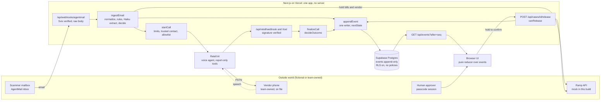

# CounterCall

**A fraudster emails accounts payable: "We changed banks, please pay the new account."** The proven defense is old and manual: put the payment on hold and call the vendor back on a number you already trust, never the one in the email. CounterCall does that callback for you, and only a person can release the money.

**Ramp flags it. CounterCall confirms it.**

| | |
|---|---|
| **Judges, start here** | https://countercall-steel.vercel.app/cases?replay=fraud (no sign-in, no keys; a recorded run, labeled REPLAY) |
| Live app | https://countercall-steel.vercel.app |
| Demo video | <!-- VIDEO_URL --> (link added at submission) |

Built for the BBS x Ramp "Automate the Old Way" hackathon (technical track). The customer (Rice Robotics) and vendor (Acme) are fictional. No real vendor, bank or Ramp account is contacted, and no real money moves.

---

## How it works

1. **Detect.** An email arrives. Deterministic rules plus Claude (`claude-haiku-5-5`) decide whether it asks to change bank details.
2. **Hold.** The vendor's scheduled payments go on hold (in the demo, two Acme bills of $12,400 = **$24,800**).
3. **Call.** A voice agent phones the vendor on the **primary number already on file**, says it is automated, and asks a question an impostor cannot answer.
4. **Decide.** Plain code (not the AI) turns what the agent heard into an outcome: **Blocked**, **Verified (awaiting approval)** or **Needs a person**. Money stays held either way. Only a signed-in person can release it.



**Case states** (`lib/policy/lifecycle.ts`; the database holds the same table and `npm run db:check` asserts they match):

```
scanning          -> cleared | flagged | needs_human
flagged           -> held | needs_human
held              -> calling | needs_human | closed
calling           -> awaiting_approval | fraud_blocked | needs_human
needs_human       -> calling | released | closed
awaiting_approval -> released | closed
fraud_blocked     -> released | closed
terminal: cleared, released, closed
```

**Where to look in the code**

| Step | Files |
|---|---|
| Email in, detection | `app/api/webhooks/agentmail/route.ts`, `lib/detect/` |
| Holds (Ramp mock) | `lib/holds.ts`, `lib/ramp.ts`, `lib/ramp.mock-db.ts` |
| The only dialer | `lib/call.ts`, `lib/voice/retell.ts` |
| Call webhooks, outcome | `app/api/retell/`, `lib/voice/finalize.ts`, `lib/voice/decide.ts` |
| Event log, state machine | `lib/store.ts`, `lib/sink.ts`, `lib/policy/lifecycle.ts` |
| UI feed | `app/api/events/route.ts`, `lib/reducer.ts`, `lib/use-events.ts` |
| Human release | `app/api/cases/[id]/release/route.ts`, `lib/release.ts` |

---

## Try it

Every run below works without signing in. Add `&at=N` to freeze at a moment (for example `/cases?replay=fraud&at=41`).

| URL | What you see | Source |
|---|---|---|
| `/cases?replay=fraud-live` | The vendor denies the change; the case is **Blocked** | Recorded **real call** |
| `/cases?replay=verified-live` | The vendor confirms with the right digits; money waits; a person releases it | Recorded **real call** (2026-11-10) |
| `/cases?replay=email-live` | A real email with calls switched off: held, handed to a person | Recorded on production |
| `/cases?replay=fraud` · `confirmed` · `voicemail` · `vague` · `impostor` | Each outcome, step by step | Generated by running scripted scenarios through the real pipeline |
| `/vendors` | Trusted numbers and where each came from (masked) | Live database |
| `/audit` | The event log, filters, JSON export, and a live integrity check | Live database |

---

## What is real, seeded and fake

| | Status |
|---|---|
| Email pipeline, Claude detection, the phone call, the outcome policy, human release, the audit log | **Real.** Calls go only to a team-owned number whose owner consented. |
| Payment holds | **Real rows in our database; Ramp is a mock** built against the Ramp Developer API's shape. The UI says **RAMP MOCK**. |
| Vendors, trusted numbers and their W-9 history, past bills and cases, company, approver | **Seeded, fictional** (`db/002_seed.sql`) |
| SPF/DKIM of injected test emails, settlement, approver identity (shared passcode + typed name) | **Fake, labeled.** Test emails from `/demo` are labeled **SIMULATED**. Nothing settles. |

Calls recorded live so far: a wrong person (ends Unverified), a denial (Blocked), and the happy path (Verified, then released by a person). Video footage is labeled "Real call · no cuts · audio lightly cleaned".

---

## Why it's safe

The design rule: **a slow or failed check means a late payment, never a wrong one.**

| Principle | What it means | Where |
|---|---|---|
| **Fail closed** | Anything unclear keeps money held and creates a task for a person. | `lib/policy/lifecycle.ts`, `lib/call.ts` |
| **The AI reports; code decides** | The email model returns JSON only. The voice agent's tools only record what it heard. The outcome function has no "released" value. Prompt injection cannot move money. | `lib/detect/policy.ts`, `lib/voice/decide.ts` |
| **Call the number we already had** | Only the vendor's primary trusted number, on file 30+ days, on an allowlist. A database trigger refuses anything else. A number is never taken from an email, prompt or request. | `lib/call.ts`, `db/001_schema.sql` |
| **A question only the vendor can answer** | Default: last 4 digits of the most recent invoice we paid them (never in any email). Fallback: last 4 of the account in the email, which proves less. The answer never reaches the agent, the logs or the browser. | `lib/call.ts`, `lib/casestore.ts` |
| **A strict bar for "Verified"** | A clear yes, the right digits, no red flags, and a second reader that also heard yes. All four. | `lib/voice/decide.ts` |
| **Only a person releases** | Hold-to-confirm button, one locked transaction, a second release is refused. | `lib/release.ts`, `components/ui/HoldButton.tsx` |
| **One append-only log** | It is both the audit trail and the UI feed. The UI never shows money optimistically. | `lib/sink.ts`, `lib/reducer.ts` |

**Guardrails for a public demo:** the agent discloses it is automated (and may be recorded) in its first sentence; calls are off in production (`CALLS_ENABLED=0`) except during recorded sessions; only allowlisted senders (`INBOUND_ALLOWED_SENDERS`) can trigger a hold; call limits per case, per vendor and per hour; every webhook is signature-checked on the raw body; phone numbers and spoken digits are masked in every public response; row-level security blocks the database from the browser; emails render as text, never HTML. `RAMP_MODE=prod` is rejected outright.

**Email prompt-injection defenses:** the model has no tools, sees no vendor data, and its output is schema-validated; hidden characters are stripped; quotes it cites are checked against the email; rules and model are combined with OR, so fooling the model alone is not enough (eval fixture 13).

California requires all-party consent to record (Penal Code §632), so the notice comes first; the FCC treats AI voices as "artificial" under the TCPA (FCC 24-17). Our reading, not legal advice. **Known gaps:** shared passcode instead of per-user identity; no strict CSP yet; someone who controls the vendor's real phone line *and* knows the last paid invoice defeats any callback, ours included.

---

## Proof

All of these run offline (no keys, no network) unless noted.

### Detection eval

20 hand-built emails (`fixtures/make.mjs`): 12 bank-change requests that must be held, 4 harmless emails that must pass, 4 other scams that must go to a person. **Read the numbers as "20 of 20 on our 20", not general accuracy.**

| Command | Result |
|---|---|
| `npm run eval:live` (real Claude, `claude-haiku-5-5`, 2026-11-10) | **20/20 correct, recall 12/12, false positives 0/4**, p50 1.8 s (max 2.7 s), $0.0041 total |
| `npm run eval` (offline replay) | 20/20, recall 12/12, false positives 0/4 |
| `npm run eval -- --det-only` (rules only, as if the AI were down) | 16/20, recall still 12/12; the 4 harmless emails go to a person instead of passing (the safe direction) |

### The system checks its own safety

| Check | What it proves | Result |
|---|---|---|
| `npm run verify:policy` | Enumerates every combination of a representative input space for the three deciding functions (including junk such as a tool argument of `"CONFIRMED_LEGIT"`). "Verified" needs all four conditions; `released` is reachable only through a person. | **20,995,238 cases, 0 unsafe releases.** This is what "0 unsafe releases" means here. |
| `npm run sim -- --seeds 200` | Replays the webhook pipeline with duplicated, reordered, dropped and forged deliveries; checks one outcome per call, no release without a person, held money never un-held. | 400 calls, 3,087 deliveries, 825 forged: all invariants held. A 6,000-seed run (11,949 calls) also held. **It found two real bugs**, both fixed. |
| `npm run audit:verify`, `/audit` | Each new log entry is sealed with a SHA-256 hash that includes the previous entry's seal, so an edit, insertion or deletion of a past entry shows up. The same check rebuilds every case's status from the log. | Production: chain intact; every case rebuilt from the log. Tamper-evident, not tamper-proof (the latest seal is published so it can be pinned elsewhere). |
| `npm test`, `npm run db:check` | Unit, flow and database tests on PGlite (in-process Postgres). | 198 tests, 12 database invariant groups |

Bugs only live runs found (all fixed): jsonb double-encoding, a regex escape inside a template literal, case ids past 9999, an import cycle in the release route, a phone number leaking into the public feed, and a race where two simultaneous events could commit out of order and the live feed could skip one (fixed by the audit seal's trigger).

---

## Run it

Node 22 or later.

```bash
git clone https://github.com/danielryang/countercall && cd countercall
npm ci
cp .env.example .env.local   # leave empty for offline work
npm run verify               # typecheck, tests, eval, database checks (offline)
npm run dev                  # then open http://localhost:3000/cases?replay=fraud
```

Useful commands: `npm run verify:policy`, `npm run sim -- --seeds 200`, `npm run scan:secrets` (fails on any tracked secret or real phone number), `npm run lint:ui`, `npm run shoot -- name="/cases?replay=fraud&at=41"` (screenshot).

**Your own deployment** (live email and calls): fill `.env.local` from `.env.example`, then

```bash
npm run db:apply          # schema into YOUR database (Supabase transaction pooler)
npm run seed:phones       # the consenting callee's number, from env
npm run setup:agentmail   # inbox + webhook
npm run provision:agent   # Retell voice agent
npm run preflight         # readiness check before a demo
```

Calls stay off until you set `CALLS_ENABLED=1`.

**Stack:** Next.js 16 on Vercel, React 19, TypeScript, Tailwind 4 + shadcn/ui · Supabase Postgres (postgres.js) · AgentMail (email) · Claude `claude-haiku-5-5` (detection) · Retell AI (voice) · Ramp Developer API shape, mock mode · Node test runner, PGlite, Playwright · Remotion (video, in `video/`).

---

## Ramp, and what is different

**Ramp already** flags new or changed vendor bank details with AI, recommends customers "double-check with your vendor through a separate communication channel" using "a verified phone number", and verifies vendor ownership ([bill pay fraud](https://support.ramp.com/bill-pay-fraud), [vendor verification](https://support.ramp.com/vendor-verification); accessed 2026-11-09). The callback itself is still the customer's job.

**Prior art, conceded:** nsKnox's [AI Agent Caller](https://nsknox.net/ai-agent-caller/) (an autonomous vendor callback agent), [Trouvé](https://github.com/Connor-W-Cahill/callback) (a similar email → hold → callback loop; there, the model's "confirmed" maps straight to approval and claimed digits are read aloud), and CallbackProof (documents human callbacks, with a hash-chained log).

**What CounterCall adds:** holds at bill and vendor level (handling Ramp's 202 "pending"); phone-number provenance enforced by the database; a challenge from our own payment history that is never read aloud; deterministic outcomes with two readers and human-only release, verified across 20,995,238 cases; and a webhook fault simulator that has already found real bugs.

---

## Why it matters

| Claim | Source |
|---|---|
| 74% of organizations were hit by business email compromise in 2025 | [AFP 2026 Payments Fraud and Control Survey](https://www.financialprofessionals.org/about/learn-more/press-releases/Details/over-75-percent-of-us-firms-experienced-payments-fraud-in-2025-while-ai-adoption-for-fraud-mitigation-lags) (AFP's detail table gives 70%) |
| Of those hit by payments fraud, 30% recovered most of the loss and 20% recovered nothing | AFP 2026, same source |
| $3.05 billion in reported business email compromise losses in 2025 (24,768 complaints) | [FBI IC3 2025 Annual Report](https://www.ic3.gov/AnnualReport/Reports/2025_IC3Report.pdf) |
| 94% of organizations use a callback to a number from official records | [AFP 2026 key highlights](https://www.truist.com/content/dam/truist-bank/us/en/documents/info/cci/2026-afp-payments-fraud-control-survey-report-key-highlights.pdf) |
| Nacha's 2026 guidance: contact the vendor using "contact information contained within your organization's internal database" | [Nacha](https://www.nacha.org/news/tips-originators-comply-2026-risk-management-rules) |

There is no published statistic for how often callbacks get skipped, so we do not quote one.

---

## Limits and roadmap

**Today:** Ramp is a mock (a sandbox client exists but is untested); email is the only trigger; nothing is written back to the Ramp bill; numbers are never quarantined automatically; no per-user identity or strict CSP; US and English only; the eval is N=20; the app screens are built for desktop (the landing page is responsive).

**Nov 19 final:** a call fallback ladder (backup phone, browser call, replay); Ramp sandbox with bank-change diffs from Ramp webhooks; strict CSP; per-user identity; a larger live eval; retries beyond one attempt.

---

## Team, license, credits

Built by Daniel Yang (github.com/danielryang) and Eric Kim (github.com/erickim73). **MIT license**, see [LICENSE](LICENSE).

Fonts: Mona Sans and IBM Plex Mono, both SIL Open Font License 1.1, via Fontsource. Thanks to Retell AI, AgentMail, Anthropic, Supabase, Vercel, shadcn/ui and Radix. Research notes are in `docs/research/`.
