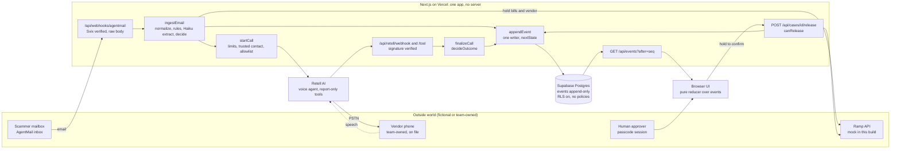

# CounterCall

CounterCall reads accounts-payable email, spots vendor bank-change requests, puts the affected payments on hold, phones the vendor on the number that was already on file, and leaves the release decision to a named human.

**Judges: open https://countercall-steel.vercel.app/cases?replay=fraud** (no sign-in, no keys; a recorded run, labeled REPLAY).

- Live app: https://countercall-steel.vercel.app
- <!-- VIDEO_URL --> Demo video: (link added at submission)

Built for the BBS x Ramp "Automate the Old Way" hackathon (technical track). The customer (Rice Robotics) and the vendor (Acme) are fictional. No real vendor, bank or Ramp production account is ever contacted, and no real money moves.

---

## Contents

1. [Pitch](#1-pitch)
2. [The flow](#2-the-flow)
3. [What is real, seeded and fake](#3-what-is-real-seeded-and-fake)
4. [Design decisions and why](#4-design-decisions-and-why)
5. [Stack](#5-stack)
6. [Eval](#6-eval)
7. [Run it](#7-run-it)
8. [Safety](#8-safety)
9. [What Ramp already does, and what is different](#9-what-ramp-already-does-and-what-is-different)
10. [Why this matters: numbers with sources](#10-why-this-matters-numbers-with-sources)
11. [Limits and the Nov 19 roadmap](#11-limits-and-the-nov-19-roadmap)
12. [Team, license, credits](#12-team-license-credits)

---

## 1. Pitch

A fraudster emails AP: "We changed banks, please pay the new account." The standard defense is old and manual: call the vendor back on a number you already trust, never the one in the email. It works when someone does it.

CounterCall does that callback for you. Claude reads the email and flags the bank change, the vendor's scheduled payments go on hold, and a voice agent calls the vendor on the primary number already on file, asks a question an impostor cannot answer, and reports what it heard. Deterministic code decides the outcome. Only a signed-in human can release the money.

Short version: **Ramp flags it. CounterCall confirms it.**

In the demo, Acme has two scheduled bills of $12,400, so **$24,800** is held.

## 2. The flow



| Step | Code |
|---|---|
| Email arrives (signature checked on the raw body, work done after the response) | `app/api/webhooks/agentmail/route.ts` |
| Normalize, deterministic rules, Claude extraction, decision | `lib/detect/ingest.ts`, `lib/detect/normalize.ts`, `lib/detect/extract.ts`, `lib/detect/policy.ts` |
| Hold bills and the vendor | `lib/holds.ts`, `lib/ramp.ts`, `lib/ramp.mock-db.ts` |
| Place the call (the only dialer) | `lib/call.ts`, `lib/voice/retell.ts` |
| Call webhooks and tool calls | `app/api/retell/webhook/route.ts`, `app/api/retell/tool/route.ts`, `lib/voice/endpoints.ts` |
| Decide the call outcome | `lib/voice/finalize.ts`, `lib/voice/decide.ts` |
| Settle calls whose last webhook was lost | `lib/voice/reap.ts` |
| One writer for every event, state machine enforced | `lib/sink.ts`, `lib/store.ts`, `lib/policy/lifecycle.ts` |
| Event feed and UI | `app/api/events/route.ts`, `lib/reducer.ts`, `lib/poll.ts`, `lib/use-events.ts` |
| Human release | `app/api/cases/[id]/release/route.ts`, `lib/release.ts` |

Email is the only trigger. The `/demo` injector (session-gated, labeled SIMULATED) feeds the same `ingestEmail()` path.

**Case states** (`lib/policy/lifecycle.ts`, mirrored in the `case_transitions` table in `db/001_schema.sql`; `npm run db:check` asserts the two are identical):

```
scanning          -> cleared | flagged | needs_human
flagged           -> held | needs_human
held              -> calling | needs_human | closed
calling           -> awaiting_approval | fraud_blocked | needs_human
needs_human       -> calling | released | closed
awaiting_approval -> released | closed
fraud_blocked     -> released | closed
terminal: cleared, released, closed
```

## 3. What is real, seeded and fake

| Part | Status | Notes |
|---|---|---|
| Email arrival (AgentMail), normalization, rules, Claude extraction, decision | **Real** | A real inbound email on production became a flagged case with $24,800 held in about 25 s (2026-11-09). Emails sent from the `/demo` injector use the same code path and are labeled **SIMULATED**. |
| LLM detection | **Real** | `claude-haiku-5-5` (`EXTRACT_MODEL`), `lib/detect/extract.ts` |
| Payment hold | **Real rows in our database; Ramp is a mock** | `RAMP_MODE=mock`, a DB-backed client built against the Ramp Developer API's shape (`lib/ramp.mock-db.ts`). The UI says **RAMP MOCK**. |
| Phone call, transcript, challenge, outcome decision, human tasks | **Real** | Retell AI, calling only a team-owned number whose owner consented. The agent says it is automated in its first sentence. |
| Human release | **Real** | Passcode session plus an 800 ms hold-to-confirm button; verified live on 2026-11-09. |
| Audit log | **Real** | Append-only `events` table; database triggers block UPDATE, DELETE and TRUNCATE. |
| Vendors, trusted phone numbers and their W-9 provenance, bank on file, past bills and cases, company, approver | **Seeded, fictional** | `db/002_seed.sql`. Seed numbers are in the fictional 555-01xx range; the real callee number reaches the database only from env via `npm run seed:phones`. |
| W-9 document, SPF/DKIM results of injected fixtures, approver identity (shared passcode plus a typed name), settlement | **Fake, labeled** | Nothing settles; no money moves. |
| `?replay=` runs | **REPLAY** | `public/runs/fraud-live.json` is a recorded real call (the vendor denies the request). `fraud`, `confirmed`, `voicemail`, `vague` and `impostor` were generated by pushing scripted scenarios through the real pipeline (`npm run make:runs`). |

Calls recorded live so far: a wrong-person call (ends Unverified, goes to a human) and a denial (ends Blocked). The happy-path call where the vendor confirms and gives the right digits has not been recorded live yet; the `confirmed` replay is generated. Video footage of the call is labeled "Real call · no cuts · audio lightly cleaned".

## 4. Design decisions and why

| Decision | Why | Where |
|---|---|---|
| **Fail closed.** Any unclear state keeps payments held and creates a human task. | A slow or failed check means a late payment, never a wrong one. | `lib/policy/lifecycle.ts`, `lib/call.ts` (every refusal creates a `verify_manually` task), `lib/holds.ts` (failed hold becomes a task) |
| **The LLM reports, code decides.** The email model returns JSON only; the voice agent's tools only record what it heard. | Prompt injection, in the email or on the call, cannot move money. | `lib/detect/policy.ts` `decide()`, `lib/voice/decide.ts` (its result can only be "held" or "held, awaiting human approval"; there is no released value) |
| **Strict bar for "confirmed".** All four must hold: a clear yes, the challenge matched within 2 attempts, no suspicious-behavior flag, and a second reader (Retell's post-call analysis) also says yes. A "no" from an AR or finance contact is a denial (Blocked). A "no" from someone else is Unverified. Yes and no together is a conflict. | Defense in depth on the only outcome that unlocks approval. | `lib/voice/decide.ts`, `lib/voice/finalize.ts`, `scripts/provision-agent.ts` |
| **The trust anchor is a number we already had.** Only the vendor's primary `trusted_contacts` row, status trusted, on file for at least 30 days, and on the `ALLOWED_DEMO_NUMBERS` list. | The attacker controls the email, not the vendor master. | `lib/call.ts`, `lib/voice/retell.ts`, DB trigger `calls_trust_guard` in `db/001_schema.sql` |
| **A challenge only the real vendor can answer, derived on the server.** Default: the last 4 digits of the invoice number on the most recent bill we paid that vendor (not in any email). Fallback, only when no paid invoice has 4 digits: the last 4 of the account number claimed in the email, which proves less. Seeded vendors all use the default. The expected digits live in one column and are never sent to the agent. | An impostor who wrote the email still does not know our payment history. | `lib/call.ts`, `cases.challenge_expected`, read only by `lib/casestore.ts` |
| **The agent never reads details aloud.** It gets the company, vendor name, a code-built one-line summary ("The request arrived by email on {date}.") and the challenge question. No email text, account numbers or amounts. | No attacker-supplied digits are repeated, and no email text reaches the voice prompt. | `lib/events.ts` `requestSummary()`, `scripts/prompt.ts` |
| **Only a human releases.** Hold-to-confirm, one transaction with a row lock, idempotent (a second release returns 409), Ramp failure rolls back. A blocked case can only be paid to the account already on file; releasing a case that needed a human requires a note of at least 10 characters. | No model, webhook or retry can reach `payment.released`. | `lib/policy/lifecycle.ts` `canRelease`, `lib/release.ts`, `components/ui/HoldButton.tsx`, `app/(app)/_parts/ReleaseDialog.tsx` |
| **One append-only log is both the audit trail and the UI feed.** The UI derives status only from `case.state` events and never shows money optimistically. | One source of truth that can be replayed. | `lib/sink.ts`, `lib/reducer.ts`, DB triggers in `db/001_schema.sql` |
| **One writer.** Every event goes through `emit()` / `appendEvent()`, which refuses an illegal transition. The database refuses it too. | The state machine is enforced twice. | `lib/store.ts`, `lib/sink.ts`, `db/001_schema.sql` |
| **Vendor-neutral Ramp interface.** `makeRamp()` picks mock or sandbox from one env var. Holds are placed on both the bills and the vendor, because a vendor hold can come back 202 (pending approval) instead of 204 (applied). | Swap the payment system without touching the pipeline. | `lib/ramp.ts`, `lib/ramp-for.ts`, `lib/holds.ts` |
| **Reserve, then dial.** A `unique(case_id, attempt)` row is written before dialing, and the Retell request carries an idempotency key. | A retried webhook can never dial twice. | `lib/call.ts`, `lib/voice/retell.ts` |
| **Plain Postgres through the pooler, polling instead of a realtime socket.** 500 ms while a case is active, 3 s otherwise. | Fits Vercel's serverless model with no always-on process. | `lib/store.ts`, `lib/poll.ts` |
| **Lazy SDK clients.** No client or env read at module scope. | `next build` imports every route module. | `lib/voice/retell.ts` |

Everything about Ramp in this repo is built against the shape of Ramp's Developer API and runs in mock mode. Nothing is written to a real Ramp account.

## 5. Stack

| Layer | Choice |
|---|---|
| App | Next.js 16 (App Router) on Vercel, React 19, TypeScript 5.9 |
| UI | Tailwind CSS 4, shadcn/ui on Radix, Motion; Mona Sans and IBM Plex Mono |
| Database | Supabase Postgres via postgres.js (14 tables, row-level security on with zero policies; anon and authenticated roles revoked) |
| Email | AgentMail inbox `rice-ap@agentmail.to`, webhooks signed with Svix (Resend route kept as a fallback) |
| Detection | Anthropic Claude `claude-haiku-5-5` for extraction, plus deterministic rules; output validated with zod |
| Voice | Retell AI agent and phone number |
| Payments | Ramp Developer API shape, mock mode |
| Tests | Node test runner via tsx, PGlite (in-process Postgres) for every database test, Playwright for screenshots |

The diagram is in [section 2](#2-the-flow). Node 22 or later.

## 6. Eval

The eval set is **20 hand-built email fixtures** (`fixtures/make.mjs`): 12 bank-change requests that must be held and called, 4 benign emails that must pass, and 4 suspicious non-bank-change emails that must go to a human task (urgent CEO wire, gift-card scam, amount outlier, lookalike invoice PDF). It is small and written by us. Read the numbers as "20 of 20 on our 20", not as a general accuracy figure.

| Command | What it does | Result |
|---|---|---|
| `npm run eval:live` | Real Claude calls, `claude-haiku-5-5` | **20/20 correct, bank-change recall 12/12, false positives 0/4**, LLM latency p50 1.8 s (max 3.4 s), $0.004 total. Run 2026-11-10; re-run with `npm run eval:live` (needs `ANTHROPIC_API_KEY`). |
| `npm run eval` | Offline replay with recorded extractions | 20/20 correct, recall 12/12, false positives 0/4 |
| `npm run eval -- --det-only` | Deterministic rules alone, as if the LLM were down | 16/20 correct, recall 12/12, false positives 4/4 |

**Misses.** Live: none. Rules-only: the 4 benign emails (07 normal invoice, 09 W-9 request, 10 newsletter, 19 third-party billing invoice) go to a human review task instead of passing. That is the fail-closed direction: with the model down, every must-catch email is still held, and nothing is cleared automatically.

The 20 fixtures: 01 obvious bank change from free mail, 02 change in an attached letter, 03 factoring partner, 04 hijacked reply thread, 05 lookalike domain, 06 urgent CEO wire, 07 normal invoice, 08 legitimate bank change, 09 W-9 request, 10 newsletter, 11 gift-card scam, 12 explicit prompt injection, 13 an injection that fools the LLM (still held, because the rules and the model are combined with OR), 14 homoglyph / punycode domain, 15 spoofed DMARC fail, 16 urgent with a phone number in the email, 17 amount outlier with the same bank, 18 IBAN switch, 19 third-party billing invoice, 20 lookalike invoice PDF only.

### Assurance: the system checks its own safety

These run offline, with no network and no keys.

**Exhaustive policy verification** (`npm run verify:policy`, `lib/policy/exhaustive.ts`). It enumerates every combination of a representative finite input space for the three deciding functions (one representative per behavioral branch, plus adversarial junk such as a tool argument of `"CONFIRMED_LEGIT"`) and runs each through the real production code. It is exhaustive over those classes, not over every possible string. Output:

```
ok decideOutcome 20,991,600 cases 0 violation(s)
ok nextState 3,318 cases 0 violation(s)
ok canRelease 320 cases 0 violation(s)
checked 20,995,238 cases exhaustively ...: 0 unsafe releases, 0 policy violations
```

It proves that "confirmed" needs all four conditions and that `released` is reachable only through a human `payment.released`. Mutation tests break the policy on purpose and check that the verifier catches each break. **This is what "0 unsafe releases" means in this project: 0 across these 20,995,238 enumerated cases.**

**Deterministic simulation** (`npm run sim -- --seeds N`, `lib/sim/`). A seeded fuzzer replays the webhook pipeline (Retell and AgentMail) on PGlite with duplicated, reordered, delayed and dropped deliveries and forged signatures, then checks invariants: one outcome per call, no release without a human, a consistent log, and held payments never un-held. A failing seed reproduces exactly with `--seed S`.

```
npm run sim -- --seeds 200
200 seed(s) in ...s | benign 67, hostile 133 | 400 calls, 3,087 deliveries, 825 forged | lost-webhook strandings settled by the reaper: 30
all invariants held on every seed
```

A 6,000-seed run covered 11,949 calls, 93,296 deliveries and 25,350 forged requests with every invariant holding. Mutation tests prove the simulator fails on broken systems. **It found two real bugs:**

1. The reaper skipped calls whose `call_ended` webhook arrived but whose `call_analyzed` webhook was lost, leaving cases stuck in `calling`.
2. The case-id default used `lpad(n, 4, '0')`, which truncates, so case 10000 collided with an existing id. Fixed with `next_case_id()` in `db/001_schema.sql`.

**Sealed audit log and replay check** (`db/003_audit_chain.sql`, `lib/audit.ts`, `GET /api/audit/verify`, `npm run audit:verify`). Every new event row stores a SHA-256 seal of its own contents plus the seal of the row before it, computed by a database trigger, so the order of the log is fixed when it is written. The verifier recomputes every seal in SQL and reports the first row that no longer matches. It catches an edited row, a deleted row in the middle, and a row inserted without its seal; it cannot see the newest rows being cut off, which is why the latest seal is published so it can be pinned somewhere else. It does not stop someone who rewrites every later seal too, so we call it tamper-evident, not tamper-proof. Rows written before the migration are counted as "before the seal" and never backfilled, because `events` is append-only.

The same endpoint replays the whole log through the pure reducer and `nextState()` and checks that it rebuilds every case's stored status. A case whose status was changed without an event shows up as a mismatch. On production, before the seal migration was applied, it rebuilt 10 of 10 cases from 109 events in 458 ms (2026-11-10).

While building this, the design review found a latent race: Postgres hands out `seq` before the insert trigger runs, so two concurrent writers could commit out of `seq` order and the `?after=` poll cursor could skip a row. The trigger now takes the case row lock, then a chain lock, and re-draws `seq` when needed, so `seq` order equals commit order equals chain order.

**Other tests.** `npm test` runs 195 tests (including the verifier and simulator tests), all on PGlite. `npm run db:check` runs 12 groups of database invariants (append-only events, illegal transitions refused, trusted-number guard, row-level security, lifecycle table equals code, redaction, and the audit seal).

Live runs also found bugs the unit tests could not see: jsonb double-encoding in postgres.js, `'\\D'` inside a JS template literal, case ids past 9999, and an import cycle that left the Ramp client undefined in the release route. A review found the public event feed leaked the full on-file phone number in one event; `toRow()` now masks every phone number before it is stored.

## 7. Run it

Requires Node 22 or later.

```bash
git clone <this repo> countercall && cd countercall
npm ci
cp .env.example .env.local   # leave values empty for offline work
npm run verify               # typecheck, tests, eval, db invariants; offline, uses PGlite
npm run dev
```

Then open http://localhost:3000/cases?replay=fraud. Replay mode needs no keys and no database. Other runs: `confirmed`, `voicemail`, `vague`, `impostor`, `fraud-live`. Jump to a moment with `&at=`: for example `/cases?replay=fraud&at=24` (detect), `at=30` (hold), `at=36` (live call), `at=41` (blocked).

Other offline commands:

| Command | Purpose |
|---|---|
| `npm run verify:policy` | Exhaustive policy verification (section 6) |
| `npm run sim -- --seeds 200` | Deterministic webhook simulation (section 6) |
| `npm run scan:secrets` | Fails if a key, webhook secret, password-bearing database URL, real phone number or tracked `.env` file is in git, or the lockfile resolves outside the public npm registry |
| `npm run lint:ui` | Static check for design tokens |
| `npm run shoot -- name="/cases?replay=fraud&at=41"` | Screenshot to `shots/name.png` (needs `npm run dev`) |

**Your own deployment** (live email and calls). Fill `.env.local` from `.env.example`, then:

```bash
npm run db:apply          # applies db/*.sql to YOUR DATABASE_URL (Supabase transaction pooler)
npm run seed:phones       # writes the consenting callee's number from env
npm run setup:agentmail   # creates the inbox and webhook, prints the secret
npm run provision:agent   # creates the Retell agent, prints its id
npm run preflight         # checks the environment before a demo
```

Calls stay off until you set `CALLS_ENABLED=1`. `npm run replay:webhooks -- <fixture|all>` replays signed Retell webhooks at a running app.

## 8. Safety

| Measure | Where |
|---|---|
| **Consent.** Only team members who agreed are ever called. The dialer throws before dialing any number not on `ALLOWED_DEMO_NUMBERS`. | `lib/voice/retell.ts` |
| **AI disclosure first.** The agent's first sentence: "Hello, this is an automated assistant calling on behalf of {company}. This call may be recorded." It answers "who is this" truthfully, and ends the call if the person objects to recording (the outcome is Unverified, so a human follows up). | `scripts/prompt.ts` |
| **Dial target from the vendor master only.** Primary, trusted, on file for 30 days. A database trigger refuses quarantined, unseasoned or other-vendor numbers. A phone number is never read from an email, prompt, tool argument or request body. | `lib/call.ts`, `db/001_schema.sql` |
| **Kill switch.** `CALLS_ENABLED=0` in production; any call attempt becomes a human task instead. Calls are enabled only during recorded sessions. | `lib/env.ts`, `lib/call.ts` |
| **Public inbox guard.** Anyone can email the AP address. A sender not on `INBOUND_ALLOWED_SENDERS` is recorded and flagged but cannot trigger a hold or a call; an empty list means nobody can. The session-gated injector bypasses it. | `lib/env.ts`, `lib/detect/deps.ts`, `lib/detect/ingest.ts` |
| **Call limits.** 3 attempts per case, 3 per vendor per hour, 8 per hour overall, one call in flight. Voicemail: the agent says nothing about the request and hangs up. | `lib/call.ts`, `scripts/provision-agent.ts` |
| **No real money.** Ramp runs as a mock. `RAMP_MODE=prod` is rejected by the env schema. | `lib/env.ts`, `lib/ramp.ts` |
| **Email prompt-injection defenses.** The model has no tools and returns JSON validated by a schema. It never sees on-file vendor data. The email sits in a block delimited by a random nonce. Text is NFKC-normalized and hidden characters (zero-width, bidi, tag characters) are stripped and counted as a signal. Quotes the model cites are located by code; a quote not found in the email raises risk. Rules and model are combined with OR, so fooling the model is not enough (fixture 13). Extraction errors fail closed. | `lib/detect/extract.ts`, `lib/detect/normalize.ts`, `lib/detect/policy.ts` |
| **Voice prompt-injection defenses.** The agent's tools only record (`report_answer`, `report_challenge`, `report_flag`, plus `end_call`). Its context holds no secrets. Pressure, new-contact or bank-detail requests are flagged and block a "confirmed" outcome. Junk tool arguments are covered by a replay scenario and by the exhaustive verifier. | `scripts/prompt.ts`, `lib/voice/scenarios.ts`, `lib/policy/exhaustive.ts` |
| **Secrets stay on the server.** Challenge digits never appear in events, prompts, call variables, logs or API responses. The public event feed masks every phone number and every digit run in transcripts and tool arguments, because the vendor speaks the answer aloud. | `lib/call.ts`, `lib/casestore.ts`, `lib/events.ts` |
| **Webhooks.** Signatures are verified on the raw body before parsing (Retell: 401 on failure; AgentMail via Svix: 400). Handlers are idempotent and do their work after responding. | `lib/voice/endpoints.ts`, `app/api/webhooks/agentmail/route.ts` |
| **Human actions.** Shared passcode session (HMAC cookie, HttpOnly, SameSite=Strict, 12 h), login rate limit, same-origin and JSON content-type checks. `/demo` and `/api/demo/*` also need `DEMO_ENABLED=1`, otherwise 404. | `lib/auth.ts`, `lib/ratelimit.ts`, `app/api/demo/` |
| **Database not reachable from the browser.** Row-level security on all 14 tables, no policies. | `db/001_schema.sql` |
| **Email shown as text, never HTML.** Security headers set in `next.config.ts`. | `components/`, `next.config.ts` |

Recording law: California requires all-party consent (Penal Code §632 and §632.7), so the recording notice comes first. The FCC (FCC 24-17, February 2024) treats AI voices as "artificial" under the TCPA. Demo calls go only to consenting teammates; there are no marketing calls and no voicemails. This is our reading, not legal advice.

Known gaps: the approver is a shared passcode plus a typed name, not per-user identity; there is no strict Content Security Policy yet. An attacker who controls the vendor's real phone line and also knows the last paid invoice number defeats any callback, ours included.

## 9. What Ramp already does, and what is different

**Ramp already** (support pages accessed 2026-11-09):

- Scans bills with AI and alerts on new or changed vendor bank details; dismissals are audit-logged ([Ramp: bill pay fraud](https://support.ramp.com/bill-pay-fraud)).
- On an alert, recommends that customers "double-check with your vendor through a separate communication channel", "using a verified phone number" (same page). The callback itself is the customer's job.
- Verifies vendor ownership, and notes this "does not guarantee against fraud" ([Ramp: vendor verification](https://support.ramp.com/vendor-verification)).
- Runs AI agents for AP ([Ramp blog](https://ramp.com/blog/accounts-payable/invoice-fraud)).

We have not seen Ramp ship an outbound verification call. Its checks are data-based (a mule account under a look-alike company name can pass a name check), and the email trigger fires before anyone edits Ramp.

**Prior art, conceded.** Holding a payment and calling the vendor is a known control, and others have built pieces of it:

- **nsKnox "AI Agent Caller"** (launched 2026-07-01): an autonomous vendor callback agent with recording and an audit trail ([nsknox.net](https://nsknox.net/ai-agent-caller/)). AI voice callback is not an empty category.
- **Trouvé** ([github.com/Connor-W-Cahill/callback](https://github.com/Connor-W-Cahill/callback), SteelHacks XIII, September 2026): the same email, hold, callback and judge loop, with good ideas (a policy rather than a score, signed webhooks, a larger eval). In that design the model's "confirmed" verdict maps directly to approval, and the claimed account digits are read aloud. Not run by us.
- **CallbackProof** (callbackproof.com): documentation and audit for callbacks a human places, including a hash-chained audit log. No calling and no hold.

**What CounterCall adds, in code that ships:**

- Holds at both bill and vendor level, handling Ramp's 202 "pending approval" response, built against the Ramp Developer API's shape (mock mode here).
- Phone-number provenance (source, source document, who added it, first seen, last verified, status), enforced by a database trigger. The seeded Acme data includes a quarantined number that the dialer refuses.
- A challenge from our own payment history that is never read aloud, and a call summary that contains no email text.
- Deterministic outcome policy, two independent readers that must both hear a yes, and human-only release, with 0 unsafe releases across 20,995,238 exhaustively enumerated policy cases (`npm run verify:policy`).
- A deterministic webhook fault simulator that has already found two real bugs.

## 10. Why this matters: numbers with sources

| Claim | Source |
|---|---|
| 74% of organizations were affected by business email compromise in 2025. | AFP 2026 Payments Fraud and Control Survey, press release 2026-04-14 ([AFP](https://www.financialprofessionals.org/about/learn-more/press-releases/Details/over-75-percent-of-us-firms-experienced-payments-fraud-in-2025-while-ai-adoption-for-fraud-mitigation-lags); [key highlights PDF](https://www.truist.com/content/dam/truist-bank/us/en/documents/info/cci/2026-afp-payments-fraud-control-survey-report-key-highlights.pdf)). AFP's detail table gives 70%. |
| Of organizations hit by payments fraud in 2025, 30% recovered most of what they lost (more than 75%) and 20% recovered nothing. | AFP 2026 survey, same sources |
| Business email compromise: 24,768 complaints and $3.05 billion ($3,046,598,558) in reported losses in 2025. | [FBI IC3 2025 Annual Report](https://www.ic3.gov/AnnualReport/Reports/2025_IC3Report.pdf) |
| 94% of organizations use a callback to an authorized contact on a number from official records; 63% of those rate it very effective (a practitioner rating, not a measured stop rate). | AFP 2026 key highlights PDF |
| Nacha's 2026 guidance: "use contact information contained within your organization's internal database to contact the vendor via phone or email." | [Nacha](https://www.nacha.org/news/tips-originators-comply-2026-risk-management-rules) |

There is no published statistic for how often callbacks get skipped; we do not quote one.

## 11. Limits and the Nov 19 roadmap

**Limits today:**

- Ramp is a mock. A sandbox client exists but has not been exercised, and some response fields in `lib/ramp.ts` are marked unverified.
- Email is the only trigger. There is no Ramp webhook route and no diff of Ramp bank-account changes.
- Nothing is written back to the Ramp bill; the evidence lives in our event log.
- A phone number is never quarantined automatically; the quarantined status, the database trigger and the dialer filter exist, and the seeded data uses them.
- No per-user identity, no strict CSP, no business-hours scheduling, no retention policy, no second channel for high-value changes.
- US and English only. The eval is N=20, hand-built. The happy-path "confirmed" call has not been recorded live yet.
- Vendors and audit pages are not built.

**Nov 19 roadmap:** a call fallback ladder (backup phone, browser call, replay, recorded video); present mode for the live final; Ramp sandbox with a bank-change diff from Ramp webhooks; strict CSP with nonces; per-user identity; vendors page and audit export; a larger live eval; a retry policy beyond one attempt.

## 12. Team, license, credits

Built by Daniel Yang (github.com/danielryang) and Eric Kim (github.com/erickim73).

**License:** MIT, see [LICENSE](LICENSE).

**Fonts:** Mona Sans (Copyright 2022 The Mona Sans Project Authors) and IBM Plex Mono (Copyright 2017 IBM Corp.), both under the SIL Open Font License 1.1, installed through Fontsource.

**Credits:** Retell AI (voice), AgentMail (inbox), Anthropic Claude (extraction), Supabase (Postgres), Vercel (hosting), shadcn/ui and Radix (components), Fontsource (fonts). Research notes are in `docs/research/`.
