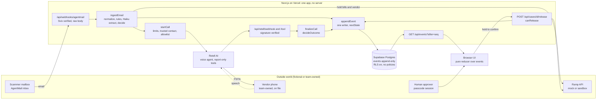

# CounterCall: implementation plan (hand-off)

Written Mon 2026-11-09, ~17:00 PST, for the implementing agent and the team (Eric, Daniel, Saketh, "the nUbers").
**Round 2 is due Tue 2026-11-10, 23:59 PT.** Submit at https://forms.gle/FxUVTm6Z75f121ov5 with the public GitHub repo, the 3:30-4:30 demo video, and the live URL. The live final is Thu 2026-11-19, evening, at Ramp's SF office.

This file is the entry point. It consolidates eight research reports, an architecture spec and a code spike into decisions, a schedule and pointers. **It does not repeat code.** All code already exists, tested, in the files named below.

---

## 0. How to use this document

### 0.1 Read order (implementing agent)
1. This file, completely.
2. `research/08-architecture.md`: **the build spec**. §0.3-0.5 decisions, §1 accounts and env, §3 schema and lifecycle, §4 repo tree, §5 API, §6 security, **§7.5 task specs S1-S12 (paste-ready prompts)**, §8 tests, and **Appendix B** (19 tested files, materialized by `npm run port`).
3. Only the research section a task spec cites. Every S-spec names its sections.

### 0.2 What exists and where (all paths under `/home/user/countercall/`)
| Path | What it is | Use it for |
|---|---|---|
| `research/00-context.md` | The brief: hackathon, pitch, rules | Background |
| `research/01-voice-agent.md` | Retell voice agent: comparison, setup, **code** (§2.4), system prompt (§3.4), tools, state machine, 20-scenario tests, logistics, legal, costs | S9 |
| `research/02-email-detection.md` | AgentMail ingestion, deterministic signals, Claude extraction, policy, 20-fixture eval. **Appendix A = 21 tested source files** | S2 (ported by script) |
| `research/03-ramp-problem-fit.md` | Ramp API mapping + `lib/ramp.ts` (mock and sandbox), what Ramp already does, competitors/prior art, **corrected stats**, Nacha, **21 judge Q&A** | S2, README, pitch, Q&A |
| `research/04-design-system-landing.md` | **Visual identity**, tokens, anti-AI rules, landing spec, stack, **prompting playbook + taste loop** | All UI work |
| `research/05-app-ui.md` | App screens (ASCII wireframes), event schema, motion table, components, **7 build prompts**, real/seed/fake table | S3-S8, S10 |
| `research/06-video-pipeline.md` | Video tools, audio-first pipeline, **Remotion skeleton**, ffmpeg recipes, costs, schedule | S11, video day |
| `research/07-video-creative.md` | Teardown of 19 launch videos, **4:12 storyboard + 24-row shot list + full VO script**, hero-call filming, AI-media rule, live-final talk plan | Video, Nov 19 |
| `research/08-architecture.md` | The reconciled build spec (see 0.1) | Everything |
| `research/09-spikes.md` | Integration proof: all research code compiled together in Next 16; conflicts + fixes; pinned versions | Debugging, version pins |
| `research/spike-web/` | The spike's working project (no node_modules, no lockfile); `research/spike-glue.patch` = its glue edits | Known-good reference when something won't build |
| `research/design/tools04/` | **`globals.css` (the tokens file)**, `halftone.py`, `slop-lint.js`, `contrast.py`, `scene-prototype.html` (landing hero scene), `renders/` | Copy into the repo (S1) |
| `research/design/app/` | `motion-proto.html` (signature app motions), `snippets/` (reducer, spans, beat, level + tests), `img/` (~40 reference captures of Ramp, Linear, Greptile, Sardine, Retell) | S1, S3-S6 refs |
| `research/design/*-viewport.png` | Greptile and 15 other reference sites | Taste references |
| `research/raw/` | Ramp OpenAPI + guides, AgentMail docs | Lookups |
| `research/design/video-refs/` | 15 contact sheets of reference videos (12 MB) | **Do not commit** |

### 0.3 What is proven vs not
- **Proven by running (no live keys):**
  - The ported 01 + 02 + 03 code type-checks strict and `next build` passes (09). `npm run verify` from an empty directory exits 0 (08 §0.2): 27 policy/lifecycle tests, eval 20/20 (replay), and 11 DB invariant groups on PGlite.
  - Svix and Retell signature checks accept valid requests and reject tampered or stale ones (09).
  - The Supabase SQL applied on real local Postgres (09).
  - A Remotion render of a Tailwind v4 app component works (06, 09). The mermaid diagrams parse (08).
- **Not yet run anywhere:** a real Claude call (`eval:live`), a real Retell call, a real AgentMail webhook, Vercel runtime behaviour (`after()`, cold start, pooler), the Ramp sandbox, and every UI screen. **G0-G2 below are the first real integration tests.**
- **Rule:** no number is spoken or shown in the video unless a script or source produced it: eval numbers come from `eval:live`, stats from 03 §3.

### 0.4 Precedence
`08-architecture.md` wins on backend, contracts and schedule, **except where this file amends it**: §13 (fixes from the independent review `research/10-plan-review.md`, which amend the 08 §7.5 S-specs; apply them whenever you paste an S-prompt), §7.4 item 4 (`evidence-strong` colour), §4.1 (personal machines and accounts) and §8.6 (Ramp chip wording). If a research file disagrees with 08, 08's override register (§0.4) explains why 08 wins.

---

## 1. The goal in one screen

**Product.** CounterCall reads every incoming AP email and catches vendor bank-change requests, including sneaky ones. It freezes the affected payments and phones the vendor **on the number that was already on file before the email arrived** (the trust anchor). An AI voice agent asks whether they really sent the request, and checks with a question only the real vendor can answer. Then deterministic code decides. Anything unclear stays held, and a human gets a task. A confirmed call still needs a human to press and hold "Release".

**What the demo must prove** (rubric: 35% technical, 25% problem fit, 20% polish, 10% creativity, 10% presentation):
1. A real email lands. It is flagged with highlighted evidence within seconds, and the bills are held through a Ramp-shaped API.
2. **A real phone call** to a teammate playing "Acme AP" streams its transcript live, ending in a stamp: BLOCKED / VERIFIED → awaiting approval / NEEDS REVIEW.
3. Fail-closed behaviour is visible: voicemail, a vague answer, and an impostor who fails the challenge all stay held.
4. The engineering is real: the policy source, the one-writer append-only event log, signature-verified webhooks, the eval with its misses, and the Ramp hold/release integration.

**Deliverables (Tue 22:00 PST target, 23:59 hard):**
- the public GitHub repo, with a README per 08 §4.3
- the video on YouTube Unlisted plus a Drive MP4 copy
- the live read-only URL
- `git tag round2-submission`

**Names.**
- Product **CounterCall**: keep it. A hackathon repo literally named "callback" exists (07 §0, 03 §2.6).
- Customer **Rice Robotics**, vendor **Acme**.
- The seed data holds **two Acme bills of $12,400 = $24,800** (invoice 4471 is in the fixtures). The VO script uses DB numbers: replace 07's $48,200 and 05's $60,950 at script lock (08 §10 #7).

---

## 2. Decisions (consolidated)

| Area | Decision | Fallback / gate | Source |
|---|---|---|---|
| Hosting | One Next.js 16 app on **Vercel Hobby**, region `pdx1`, no always-on server | Pro ($20) only if a Hobby limit bites | 08 §1.1 |
| Voice | **Retell AI**: Retell-bought US number, **Claude Sonnet 5.5** inside Retell, webhooks incl. `transcript_updated`, three **report-only** tools | **Vapi** + upgraded Twilio number, **staged tonight** (§4.2 row 13) so the Tue 09:00 decision is real; see §13 H1 for the reduced fallback. **Never a Twilio trial** (blocks streams, recording; adds a spoken preamble) | 01 §0, §2, §5.1 |
| Email in | **AgentMail** inbox `rice-ap@agentmail.to`, Svix-signed webhook. Subscribe to `message.received` **+ `.unauthenticated` + `.spam`** | Resend receiving (same Svix scheme) | 02 §0, §1 |
| Detection | Deterministic rules first (auth results, From/Reply-To, lookalike domain, ABA/IBAN checksum, differs-from-file, urgency, secrecy, phone in email), then one **`claude-haiku-5-5`** call with `output_config.format` (zod schema, no tools, no vendor data). `bankChange = rules OR llm` | `EXTRACT_MODEL=claude-sonnet-5-5` is one env var | 02 §3-5 |
| Evidence highlights | LLM returns **quotes**; the server resolves and verifies offsets (`spans.ts`) | n/a | 05 §0 #6 |
| DB + live UI | **Supabase Postgres as plain Postgres** via the transaction pooler (postgres.js, `prepare:false`, `max:1`). **No browser DB client, no Realtime.** The UI polls `GET /api/events?after=<seq>` every 500 ms | **Neon** is a drop-in swap (only `DATABASE_URL` changes) | 08 §0.3 #1, §0.4, §1.3 |
| Events | **One canonical event union** (`lib/events.ts`, B.5) and **one writer** (`appendEvent`/`emit`). The `events` table is append-only (triggers) and serves as both the audit log and the UI feed | n/a | 08 §2.3, §3.5 |
| Case state | A state machine as data (`lib/policy/lifecycle.ts`), enforced twice (TS + DB trigger, proven identical). Only a human `payment.released` reaches `released` | n/a | 08 §3.4 |
| Post-call policy | **`decideOutcome()` only** (01) → `CONFIRMED_LEGIT` / `DENIED_FRAUD` / `UNVERIFIED`. CONFIRMED needs yes + challenge match + second-reader agreement + no flags. 02's `postCallDecision` stays eval-only | n/a | 08 §0.4 |
| Release | **Human-only, hold-to-confirm, never optimistic.** A confirmed call → `awaiting_approval` | No auto-release exists in code | 08 §2.2 |
| Challenge | **Last 4 digits of the vendor's last PAID invoice number**, derived server-side. It never enters events, prompts, dynamic vars, logs or API responses. The agent forwards what the vendor *said* and never learns whether it matched | No paid history → yes/no only → cannot reach `awaiting_approval` | 08 §2.5, 01 §3.3 |
| Dial rule | Only the primary `trusted_contacts` row, and only if it is on `ALLOWED_DEMO_NUMBERS`. A number in the email is displayed struck through as "never dialed" | n/a | 01 §0, 08 B.15 #4 |
| Rate limits | One open case per vendor+bank, 3 calls per vendor per hour, 1 call in flight, the allowlist as the real cap | n/a | 08 §2.4 |
| Ramp | `lib/ramp.ts` `makeRamp()`; **`RAMP_MODE=mock` by default and in the Round-2 video** (DB-backed mock mirroring real shapes). Hold at **bill and vendor level**; treat 202 as pending | Sandbox opt-in, gate **Tue 10:30** | 03 §1, 08 §2.6 |
| Stage | App laid out for **1280×720**, recorded at 1280×720 CSS px, DPR 2, `<html data-scale="video">` (13 px micro labels) | n/a | 08 §2.1 |
| Auth | Passcode session for every human/demo action; public read-only (all data fictional and masked); demo routes 404 unless `DEMO_ENABLED=1` | n/a | 08 §6 |
| Design | **"Safety paper and signal"** (§7). Claude Code builds straight from tested tokens, followed by a Playwright screenshot + slop-lint + rubric loop. **No Figma-first, no v0/Lovable/Figma Make** | Stitch / Claude Design for ideation only | 04 §0, §4.3-4.4 |
| Landing page | **Tier 2** (cut first). Until then `/` is a 20-line hero linking to `/cases` | n/a | 08 §0.4, §7.6 |
| Video | Screen Studio capture + **Remotion** graphics + **team's own VO** + Uppbeat music + synthesized phone SFX; audio-first; 1080p30, -14 LUFS | Cap, then DaVinci Resolve | 06 §0 |
| AI media | **No AI video, no avatars, no AI voice.** At most one halftone handset still, CC0 photo preferred | n/a | 07 §4 |
| Hosting the video | **YouTube Unlisted + Drive "Anyone with the link" MP4**, tested in incognito | n/a | 06 §5 |

---

## 3. The invariants (the safety story; also the best Q&A answers)

These are binding in the repo `CLAUDE.md` (08 Appendix B.15). Never trade them for speed.
1. **Fail closed.** Any unclear state keeps payments held and creates a human task.
2. **The LLM never releases money, never chooses a phone number, never sets a state.** It reports; `decideOutcome()` and `nextState()` decide; `canRelease()` + the human route are the only path to `payment.released`. On screen: "model heard NO → policy rule R3 decided KEEP HELD" (05 §2.4).
3. **One writer.** Every event goes through `emit()`. `events` is append-only; corrections are new rows.
4. **Trust anchor.** We dial only the vendor's primary on-file number, which must be on `ALLOWED_DEMO_NUMBERS`. A phone number is never read from an email, prompt, tool argument or request body.
5. **Secrets stay server-side.** Challenge digits live only in `cases.challenge_expected`.
6. **Webhooks** verify the signature on the raw body first, are idempotent, and answer fast (work happens in `after()`).
7. `request_summary` is built in code, never from email text (emails are attacker-controlled; prompt-injection defence).
8. **Never log** full phone numbers, full bank numbers, keys or challenge digits (`toRow()` redaction).
9. The UI derives everything from events through a pure reducer; status comes only from `case.state`; money is never optimistic.
10. **No SDK client or `env()` at module scope** (it crashes `next build`). Never enable `cacheComponents` (Next 16 default in `create-next-app`, so don't use `create-next-app`).

---

## 4. Tonight (Mon Nov 9): humans only, start now

### 4.1 Use personal machines and personal accounts
The research ran in a sandboxed environment with a non-default npm registry and API endpoint. **Build the hackathon project on personal laptops, with personal accounts and API keys** (Anthropic, Retell, AgentMail, Supabase, Vercel, GitHub, Screen Studio). The lockfile must be generated on a laptop against the public registry: `grep '"resolved"' package-lock.json | grep -vc registry.npmjs.org` must print 0 (08 §0.5 A8). This also keeps Remotion's free licence (individuals / teams of up to 3) clean (06 §2.2).

**Moving the research:** copy the hand-off bundle to a laptop. `handoff/countercall-handoff.tar.gz` contains this file, all research `.md`, `design/tools04`, `design/app`, the reference viewports, `spike-web` and `raw/`; it skips the 12 MB video contact sheets and full-page PNGs.

### 4.2 M0 checklist (08 §1.2; owner = suggested role)
Roles: **R1 Backend = Daniel, R2 UI + producer = Eric, R3 Voice + capture = Saketh** (swap freely).

| # | Do | Who | By | Cost | Notes |
|---|---|---|---|---|---|
| 1 | **Retell**: account on a real-domain email, **card added**, budget $50, auto-recharge off, **buy one US number**, note the purchase time | R3 | **first, now** | $2/mo | A new number can reject outbound with HTTP 409 for ~2 min. Retell may pause an agent it suspects of vishing: honest disclosure first, low volume (01 §2.2, §4.6) |
| 2 | **Ramp sandbox form** (self-serve, ~1 min advertised, unverified) | R1 | now, 5 min | free | Build against the mock regardless; gate Tue 10:30 (03 §1.5) |
| 3 | GitHub repo `countercall` (public) + 2 collaborators | R1 | 17:30 | free | Secret scan before the first push (08 §8.6) |
| 4 | Supabase project, region West US (Oregon), a password with no special characters | R1 | 17:30 | free | Copy the **Transaction pooler** URI (port 6543) → `DATABASE_URL` |
| 5 | Anthropic Console key, workspace spend limit $20 | R1 | 17:30 | ~$1 | Model ids `claude-haiku-5-5`, `claude-sonnet-5-5` |
| 6 | AgentMail account + API key; create **only** the scammer inbox (or use a throwaway Gmail) by hand. `npm run setup:agentmail` creates `rice-ap` itself (if the name is taken, use `rice-ap-<4 chars>` and update the seed) | R1 | 18:00 | free | Never spoof a domain with DMARC `p=reject`: AgentMail silently drops it (02 §1.6) |
| 7 | Vercel project linked to the repo | R1 | 18:00 | free | Env on **Production** |
| 8 | **Callee consent**: the teammates whose phones receive calls agree in writing (screenshot to Drive) | R3 | tonight | n/a | The agent discloses "automated assistant, call may be recorded" at the top of every call (CA two-party consent, 01 §6) |
| 9 | Callee phones: **turn off "Silence Unknown Callers" and call screening**, voicemail greeting under 3 s, place a test call from a second handset to check for "Spam Likely" | R3 | tonight | n/a | 01 §5.3, 08 §8.5 |
| 10 | Screen Studio ($29/mo; student 40% off) + macOS Screen Recording, Accessibility, Mic permissions; Cap as the free fallback | R2 | 20:00 | $29 | Export is locked until paid (06 §2.1) |
| 11 | Drive folder `countercall-video/` + YouTube channel for Unlisted upload | R2 | tonight | free | |
| 12 | Optional: VO drafts for the problem / architecture / close paragraphs (closet, phone mic OK), **from the patched 07 §3.3** | R2 or R3 | 22:00-23:00 | free | Re-record Tue 14:30 (§8.7) |
| 13 | **Stage the voice fallback**: Vapi account + Twilio upgrade (~$20) + one number imported into Vapi; record the SIDs. Do not build anything yet | R3 | tonight, 20 min | ~$20 | Makes the Tue 09:00 decision real (§13 H1) |
| 14 | **Read the submission form** in a private window and signed in: copy every field, link type and length limit into §8.7; draft the text answers; name who clicks Submit (plus a second person watching) | R2 | tonight | free | §13 M14 |
| 15 | **Move the bundle to the laptops** through a channel the research environment allows (a private GitHub repo/release from a personal account, or Drive); test it with one file first | Eric | **now** | free | Step zero for everyone (§6.5) |
| 16 | Confirm the three of you are **co-located Tue 11:00-14:00** for the shoot, and each check your Claude Code plan/API limits | all | tonight | n/a | §13 H7, M12 |

**G0 target: Mon 19:00.** S1 done (scaffold, port, deploy, DB applied, `/api/health` returns `ok` from a real query).

---

## 5. Architecture

### 5.1 Diagram (paste into the README and the video's architecture card; validated, 08 §4.2)

### 5.2 One request, end to end
1. **Ingest.** The email arrives at AgentMail (or `POST /api/demo/inject`, which runs the same `ingestEmail()`, tagged `source:'injector'` and labelled SIMULATED in the UI). The webhook verifies Svix on the raw body, dedupes on the event id, returns 200 and continues in `after()`.
2. **Detect.** Normalize to the reply-extracted body: quoted old bank details must not trigger (02 fixture 04). Deterministic signals run, then one Haiku extraction. The policy (pure `decide()`): any bank-change email for a known vendor → **HOLD + CALLBACK**, however legitimate it looks. Risk only sets severity. Events: `email.received`, `case.flagged`, `case.state`.
3. **Hold.** `ramp.holdBill()` for each scheduled bill, plus `holdVendor()` (204 or 202 pending). Event `payment.held` drives the hatch "frozen" animation.
4. **Call.** `startCall()` checks the limits, the primary trusted contact, the allowlist, and derives the challenge server-side. It reserves the call row, then calls `createPhoneCall` with dynamic vars that hold **no secrets** (company, vendor name, code-built request summary). Event `call.created`.
5. **Converse.** The Retell agent opens with the disclosure, reaches Acme AR, asks the question, runs the challenge, and handles voicemail, transfer, vague answers, "just approve it", requests for our bank details (never reveal) and injection. It calls `report_answer` / `report_challenge` / `report_flag` via signed tool calls (<1 s), producing `call.tool` events. `transcript_updated` webhooks produce `call.transcript.delta` (whole-transcript snapshot, replaced idempotently; the UI paces the reveal at about 15 chars/s so text doesn't outrun the audio).
6. **Decide.** On `call_analyzed` (webhooks are unordered and retried), `finalizeCall()` runs once (idempotent) → `decideOutcome()` → `call.outcome` with a rule trace → `case.state`: `fraud_blocked` / `awaiting_approval` / `needs_human` (+ `task.created`).
7. **Release.** Only from `awaiting_approval` (or `on_file` destination from other states per 08 §5): the human holds the button for 800 ms, `canRelease()` runs, `ramp.release*()` runs, then `payment.released`.

Data model (tables, enums, seed of Rice Robotics + 6 vendors with provenance and scheduled bills): **08 §3 + B.3/B.4**. Lifecycle states and the who-may-cause-what table: **08 §3.4**. API routes (17, with auth, status codes, idempotency): **08 §5**. Security minimums: **08 §6** (passcode session + Origin check, demo key + allowlist + rate limit, raw-body signatures, no `NEXT_PUBLIC_` secrets, RLS on with zero policies, prompt-injection stance).

### 5.3 Costs
| Item | Cost | Source |
|---|---|---|
| Retell number | $2/mo | 01 §7 |
| Retell calls (~50 tests × 2 min, ~$0.09-0.15/min all-in) | ~$30-35 | 01 §7 |
| Anthropic (eval + demo; Haiku ≈ $0.0004/email) | ~$1 (cap at $20) | 02 §7 |
| AgentMail, Supabase free, Vercel Hobby, Ramp sandbox, Uppbeat free, fonts (OFL) | $0 | 02, 08, 06, 04 |
| Screen Studio, one month | $29 (student discount available) | 06 §7 |
| Optional: ElevenLabs Starter (VO fallback / music) | $1 first month | 06 §7 |
| Optional: lookalike domain for the scammer scene | ~$10 | 02 §1.6 |
| Optional: Supabase Pro if paused before Nov 19 | $25 | 08 §1.3 |
| Vapi staging: Twilio upgrade + number (§13 H1) | ~$20 | 01 §2.7 |
| Claude Code for 3 people (each person's plan or API budget; usually the biggest cost) | varies | §13 M12 |
| **Total (services)** | **≈ $55 minimum, ≈ $85-100 recommended** | |
| Production unit cost (pitch) | ≈ $0.13-0.30 per verification call; < $0.001 per email | 01 §7, 02 §7 |

---

## 6. Build plan

### 6.1 Lanes
| Lane | Human | Owns | Then |
|---|---|---|---|
| Backend | R1 Daniel | S1 accounts and deploy, S2 pipeline, S7/S8 routes (until Tue 11:00) | Remotion scenes (S11), `eval:live`, drives the live demo |
| UI + producer | R2 Eric | S3 contract, S4-S7 UI (until the **13:00 UI freeze**) | script lock, VO, edit, mix, README (S12) |
| Voice + capture | R3 Saketh | Retell setup, S9 voice integration, call tests (until Tue 11:00) | hero and variant shoots (plays Acme), screen capture |

### 6.2 Clock and gates (PST; 08 §7.2)
| Gate | When | Done when |
|---|---|---|
| **G0** | Mon 19:00 (may slip to 21:00 without moving G1) | S1: `npm run verify` green; Vercel deploys `main`; `db:apply` ran; `/api/health` hits the DB |
| **G1** | Mon 23:00 (hard Tue 09:00) | A real email (or inject) → case with evidence, frozen bills, `case.state` events on the deployed URL |
| Vapi decision | Tue 09:00 | Only if Retell blocks us (01 §2.7) |
| **G2** | Tue ~09:30 (**hard 11:00**) | A real call to a teammate: "No" → DENIED_FRAUD → stamp BLOCKED; "Yes" + right digits → `awaiting_approval`; human release works |
| **G3** | Tue 10:30 | Ramp mode frozen (mock unless the sandbox works end to end) |
| **G4** | Tue 11:00 | Feature freeze (fixes only); shooting starts |
| **G5** | Tue 13:00 | **UI hard freeze** (a changed screen must be re-shot) |
| `eval:live` | Tue 12:00 | `unset ANTHROPIC_BASE_URL`; the table + misses go into the README and the video |
| **G6** | Tue 14:00 | Hero + variants shot; golden runs exported to `public/runs/` |
| **G7** | Tue 21:30 | Upload verified in a private window (YouTube + Drive) |
| **G8** | Tue 22:00 | Form submitted; tag pushed. Hard stop 22:30 |

Overnight Mon: sleep after G1. Tue 07:00: 10-minute sync.

### 6.3 Critical path
Retell account + number (now) → deployed webhook URL (G0) → `npm run provision:agent` (needs `PUBLIC_BASE_URL`) → first call to R3's own phone → S9 wiring (`call.created`, signed webhooks, `finalizeCall`, `case.state`) → **G2** → rehearsal → hero shoot → edit → upload. **R3 tunes the script in Retell web-call mode (no telephony) while the number warms up** (01 §2.6). The UI path (S3 → S4-S7, about 8 focused agent-hours) has slack. The landing page, audit page, vendors page and Ramp sandbox are all off the path.

### 6.4 Task specs (full paste-ready prompts: 08 §7.5)
Common preamble for every agent: *"Read CLAUDE.md, then the sections named below. Do not touch files outside the list. Finish by running `npm run verify` and the Done-when command and pasting the output. If a check fails, fix the cause; never weaken a test."*

| ID | Task | Owner | After | Box | Done when (short) |
|---|---|---|---|---|---|
| S1 (**split S1a/S1b, §13 H6**) | Scaffold via `scripts/port-research.mjs` (B.9; **no `create-next-app`**), `npm i` on a laptop, shadcn init into `components/shadcn/`, copy `globals.css` + tools + snippets, health route, deploy, `db:apply` | R2 launches, R1 reviews | repo exists | 90 min | `verify` green; `/api/health` ok |
| S2 | Backend core: `env.ts`, `store.ts`, detect deps, `ramp.ts` + DB mock, auth, ratelimit, AgentMail webhook, `/api/events`, seed/reset scripts | R1 | S1 | 3 h | Mail or inject → `email.received`, `case.flagged`, `payment.held`, `case.state`; replay twice = one case; builds with **no** keys |
| S3 | Contract: reducer on canonical events, 500 ms poll hook, `public/runs/fraud.json`, `/dev/states?run=&at=` | R2 | S1 | 75 min | Reducer tests pass; `/dev/states?run=fraud&at=6` renders |
| S4 | Shell + queue (TopBar, Frame, Chip, QueueRow 52 px, KpiTicker, J/K) | R2 | S3 | 90 min | `lint:ui` 0; `shoot` PNGs show the seeded queue |
| S5 | Case detail (EmailPane, EvidenceText sweep, SignalRow RULE vs MODEL, PaymentRow hatch, TrustedNumberCard with the struck "never dialed" number) | R2 agent B | S3 | 90 min | Screenshots at `at=2,4,6` pass the 05 §6.4 rubric |
| S6 | Live call panel (the only dark surface; StateRail, Transcript paced, ChallengeSlots filled/empty only, Stamp only from `call.outcome`, "AUTOMATED CALL" chip) | R2 agent C | S3 | 90 min | `/dev/states` shows every terminal state |
| S7 | Decision bar + ReleaseDialog (rule trace, 800 ms hold, no optimism) + routes | R2 + R1 | S3, S2 | 75 min | Release from `awaiting_approval` works; from `held` → 409 |
| S8 | Demo panel: preflight, scenario cards, inject, reset (<3 s), REPLAY/STEP, present mode `P`, `?replay=` offline | R1 + R2 | S7, S2 | 75 min | Reset → clean queue + seeded history |
| S9 | Voice: `lib/call.ts`, Retell webhook/tool routes → `emit`, `provision-agent.ts` (`transcript_updated`, `voicemail_option` set, disclosure first), 6 signed replay fixtures | R3 | S1, Retell, S2 | 3 h | `replay:webhooks -- all` gives 6 expected outcomes; a real call ends correctly |
| S10 | Audit, vendors, palette (cut-line) | R2 | M4 | 90 min | Only if G5 is met with time spare |
| S11 | Remotion project in `/video` (scenes: problem, stats, architecture, policy source, eval card) | R1 | S1 | 3 h Tue | `npx remotion render` draft exits 0 |
| S12 | README (08 §4.3, 12 sections, `eval:live` table), docs copy; landing (Tier 2) last | R2 | M4 | 60 + 90 min | README complete; fresh clone verifies |

### 6.5 Running the agents
- **S1 runs first and alone**: nobody branches before G0, so the lockfile, the port and the deploy settings exist exactly once. After that, use one git worktree per agent (`git worktree add ../cc-s5 -b s5`), small PRs, merge often. `main` auto-deploys, so **never push a red `npm run verify`**.
- **Models:** use the strongest model (Opus 5.5) for S3, S5, S6 and every taste-loop round, where design judgement is the score. Use Sonnet 5.5 for S2, S8, S9, S11 and S12 (mostly porting and wiring). One lead session per human; spawn subagents only for the S-specs above.
- **Before S1 (exact commands):** `cd ~/work && tar xzf countercall-handoff.tar.gz && git clone <repo> countercall && cd countercall && mkdir -p docs/research scripts && cp ../handoff/PLAN.md ../handoff/research/0[0-8]-*.md docs/research/`. Do **not** copy `09-spikes.md` or `10-plan-review.md` into the public repo; read them from `../handoff/research/`. Before the first push, scan for internal hostnames and secrets (08 §6). In the bundle, every `research/...` path in this file is `../handoff/research/...` relative to the repo clone.
- **Lead-agent kick-off prompt** (paste into Claude Code in the empty repo clone after M0):
  > Read `docs/research/PLAN.md`, then `docs/research/08-architecture.md` §0, §1, §4, §7 and Appendix B.9. Execute S1 exactly as specified in 08 §7.5: port with `scripts/port-research.mjs`, no `create-next-app`, lockfile from the public registry, shadcn into `components/shadcn/`, tokens from `../handoff/research/design/tools04/globals.css`, snippets from `../handoff/research/design/app/snippets/`. Apply PLAN §13 (it splits S1 into S1a/S1b and amends S2-S9). Do not write product code. Stop when S1a's checks pass and the commit is pushed, then print the S1b-S9 prompts from 08 §7.5 **with the PLAN §13 amendments merged in** and paths adjusted to this repo, so the team can launch them in parallel worktrees.
- When something won't build, diff against `research/spike-web/` and read `research/09-spikes.md` §conflicts (cacheComponents, lazy clients, `.ts` imports, `"type":"module"`, Remotion `@source`, svix `verify()` returning void, async `Retell.verify`).

### 6.6 Cut lines (08 §7.6)
Cut top first:
1. Landing page.
2. S10, in this order: hash chain, `?` sheet, cmdk, vendors page, sonner, audit page.
3. Ramp webhook / sandbox.
4. Web-call mode, the Resend fallback, motion #8-12.
5. Remotion tilt, then the ArchDiagram becomes a still, then music becomes silence.
6. Video variant V2, then V3.

**Never cut:**
- the evidence sweep, freeze, call panel, stamp, and hold-to-confirm release
- demo-panel preflight and reset, and `?replay=`
- the real-call hero take
- VO, captions and loudness
- the policy tests, and the **`eval:live` numbers before any number is shown**

**Slip rules:**
- G1 missed by Tue 09:00: R1 and R2 pair on the pipeline.
- G2 missed by 11:00: shoot the hero with a manually triggered real call. **Never a mock.**
- G5: freeze anyway, and cut unready screens from the storyboard.

### 6.7 Verification (08 §8)
- **Gates:** `npm run verify` = typecheck + 27 tests + eval replay + eval unit/smoke + db:check. Also `lint:ui` and `replay:webhooks -- all` (confirmed, denied, voicemail, vague, impostor, injection, plus out-of-order and duplicate delivery).
- **Before every shoot:** the 10-minute deployed smoke in 08 §8.4 and the pre-recording checklist in 08 §8.5.
- **Before submission:** the checklist in 08 §8.6: secret scan, public repo, fresh-clone verify, read-only URL refuses `/api/demo/inject`, webhooks point at production, video opens in incognito with captions, tag pushed.

---

## 7. Design system: the part that stands out most

Source of truth: `research/04-design-system-landing.md` and the tested `research/design/tools04/globals.css`. App specifics: `research/05-app-ui.md`. Look at `design/tools04/renders/specimen-hero.png`, `hero-scene-stage4.png` and `design/app/img/proto-t4200.png` before writing any UI. Note that `proto-*` still uses 05's placeholder Greptile palette; re-skin it with 04's tokens.

### 7.1 Direction: "Safety paper and signal"
Greptile's grammar, re-skinned around **bank-check security print + a live phone line**. Every motif is tied to the product (04 §3.1).
- **Keep from Greptile:** dashed 1px hairline rails, mono UPPERCASE micro-labels, **0 radius**, halftone art, cut-corner (45° chamfer) buttons, dense cells.
- **Ours:**
  - `+` registration marks at frame corners
  - microprint rules
  - eyebrows like `No. 02 — THE CALL`
  - `FIG. 01 / LIVE INTERCEPT` captions
  - a rotated **BLOCKED rubber stamp**
  - `--hatch` (45°, 1px, 6px pitch) as the "frozen money" pattern, which survives greyscale and video compression
  - the call card as the **only dark surface** (the visual climax)
- **Voice:** confident, specific, AP nouns. No "supercharge", "seamless", "revolutionize" (04 §3.8).

### 7.2 Tokens (paste-ready in `globals.css`; 04 §3.3-3.9)
| Role | Value |
|---|---|
| Paper / raised / sunk | `#E9E6DE` / `#F4F2EC` / `#DCD8CE` |
| Ink / ink-2 / muted / faint | `#14161D` / `#2B2F3B` / `#5C6170` (4.95:1) / `#8A8E9C` (decorative only) |
| Night (call card, dark sections) / chalk | `#12141A`, `#1B1E27`, `#0C0D12` / `#ECE9E1`, `#A9A79F` |
| Signal (brand, primary CTA, **CALLING**) | `#1B4DFF` flat (4.74:1 on paper); `signal-ink #1743E0`; `signal-soft #7C9BFF` on night |
| Highlighter (`evidence`) | `#F7E26B` |
| Status (glyph + text + fill, never colour alone, never body text) | HELD `#FFB81C` (pause bars) · CALLING `#1B4DFF` (pulsing square) · VERIFIED `#22B866` (check) · BLOCKED `#D42A14` (x) · NEEDS_REVIEW `#EE6DB8` (triangle) |
| Fonts | **Mona Sans** (variable; display 800 with width axis, body 400) + **IBM Plex Mono** (labels, money, ids, timers, stamp at 600). OFL, ~143 KB, via fontsource 5.3.0 |
| Shape | radius 0, no shadows, no gradients except `--hatch`; Tailwind defaults wiped with `--color-*: initial`, so `rounded-xl`, `shadow-lg`, `bg-indigo-500`, `white`, `black` **do not compile** |
| Type at 1280×720 | body 15/24; micro 11/16 mono caps (13/18 under `data-scale="video"`); title 20/24; stamp 26-28; timer 32 tabular |
| Motion | `--d-instant/fast/base/slow/stamp/settle` = 80/120/200/400/220/600 ms; `--beat-gap` 700 ms; `--ease-out/in/snap`; 8 px max travel; **no springs**; reduced-motion branch for each |
| Density | Queue rows 52 px (two lines); ledger/audit rows 36 px; header rows 32 px; money right-aligned, `tabular-nums` |

### 7.3 Why AI-generated UIs look AI-generated, and our counter-rules (04 §2)
The five ways this goes generic if ignored (04's top five):
1. **Not wiping the Tailwind/shadcn defaults.** Rounded cards, soft shadows, indigo and Inter creep back. Counter: keep `--color-*: initial` and `--radius: 0px` (never `0`), remove lucide, and map shadcn variables to our tokens (04 §7 token map).
2. **Letting the model choose fonts, palette or icons**, or "fixing" a bland section with gradients, glow, glass or icon cards. Counter: tokens only; never add a font, dependency, radius, shadow or gradient to fix layout; icons are hand-written 12 px SVG with butt caps and miter joins.
3. **Uniform fade-ups and springs everywhere.** Counter: scripted moments only: load, the hero scene, the stamp. Every motion explains a state change (05 §4).
4. **Stock or blob art.** Counter: the live product scene, the transcript, or the baked two-ink halftone handset.
5. **Skipping the screenshot loop.** Counter: `lint:ui` + `slop-lint.js` + reading the PNGs every round (§7.8).

Other tells to avoid: a centred hero + three icon cards, purple/indigo (hue 250-295), glassmorphism, emoji, shimmer badges, `transition: all`, equal section heights.

### 7.4 Resolved design conflicts (04 §7 ↔ 05)
1. **Frame ticks:** `+` registration marks everywhere (08 B.15).
2. **Label tracking:** 0.14em on the landing page; `[data-app] { --tracking-label: 0.08em }` on the app layout (08 B.15).
3. **Stamp font:** Plex Mono 600 in the app and on the landing hero; the display font is only for the footer wordmark (08 B.15).
4. **`evidence-strong`** ("who / where the money goes" highlight): **a cobalt tint, `color-mix(in oklab, var(--color-signal) 28%, white)`, not pink.** Pink is NEEDS_REVIEW, and a NEEDS_REVIEW case would otherwise show pink highlights next to a pink chip. *[decision made in this plan]*
5. **Stage:** 1280×720 with `data-scale="video"` (08 §2.1).

### 7.5 App: screens and the motions that tell the story (05 §2, §4)
- **Shell:** TopBar (live dot, HELD $ ticker), queue 360 px + detail 920 px, keyboard J/K, `data-app`. One focal element per story beat, and no scrolling at any beat on 1280×720.
- **Queue:** 52 px two-line rows, status chips, row-insert animation.
- **Case detail, a "case file that assembles itself":** the email on the left with highlight spans. On the right, phase panels (CHECKS → PAYMENTS → VERIFY) collapse into one-line receipts as the story advances:
  - signal rows labelled RULE vs MODEL
  - frozen payments with hatch over the amount
  - the **trusted-number card with provenance** ("added 2025-03-14 from signed W-9 — not from this email")
  - the email's phone number **struck through, "NEVER DIALED"**
- **Live call card (dark):** a state rail (DIALING → CONNECTED → ENDED/FAILED, with ring time derived from `call.created`), the paced transcript with speaker labels, challenge slots (filled/empty only), an "ACTIVITY" meter (VAD-driven; never fake amplitude presented as audio), "AUTOMATED CALL · disclosed 0:02", and the **outcome stamp** (rendered only from a real `call.outcome`, or tagged REPLAY).
- **Decision bar:** a rule trace ("model heard NO → policy R3 → KEEP HELD"), the action matrix by state, and a hold-to-confirm release dialog (800 ms, approver from the session, a note required for `needs_human`).
- **Demo panel (hidden, gated):** preflight (`STAGE 1280×720 OK`, `RAMP MOCK` chip, allowlist count), scenario cards with a callee cheat-card, inject, reset, REPLAY/STEP, and present mode `P` (nav hidden, 125% type, no toasts, cursor ring).
- **Signature motions** (prototyped in `design/app/motion-proto.html`, durations in 05 §4):
  - the evidence highlight sweep
  - the "never dialed" strike
  - the freeze (hatch wipes over the amount + lock)
  - the call card rising
  - transcript streaming at audio pace
  - the stamp (220 ms, slight rotation, no bounce)
  - NumberFlow on the HELD ticker
  - beat scheduler: bursts of events animate in sequence with a 700 ms gap
- **Components:** shadcn (dialog, sheet, command, sonner, tooltip) restyled and generated into `components/shadcn/`; motion; @number-flow/react; use-stick-to-bottom. **No TanStack Table, no lucide, no v0.** `components/ui/*` stay pure (no `next/*`) so Remotion can import them.
- **Real vs seeded vs fake (05 §6.5):**
  - Real: email → detection → call → outcome → audit log.
  - Seeded: vendors, W-9 provenance, past cases, approver.
  - Fake and **labelled**: Ramp mock, auth results of injected fixtures, settlement.

### 7.6 Landing page (Tier 2; 04 §5)
Built only after the README, and only if time remains. Sections:
1. **Hero:** the poster headline "Call the number you already have.", left-aligned. Beside it, the live 13.4 s `InterceptScene` (email → HELD → dial the on-file number, not the email's → CALLING transcript → BLOCKED stamp). Prototype: `tools04/scene-prototype.html`.
2. **Problem:** "One forged email. One wire. No way back." Use 03's sourced stats only.
3. **How it works:** four uneven steps: Detect, Hold, Call, Decide.
4. **Transcript widget** (dark) with three outcomes.
5. **The trust anchor:** why a phone call.
6. **Ramp integration flow.**
7. **CTA + footer:** over a slow Paper Shaders `Dithering` (pinned 0.0.82), with a cropped giant wordmark.

Copy for every section, motion specs, responsive notes and a perf budget are in 04 §5.

### 7.7 Illustration: the halftone handset (04 §3.6, 07 §4.3)
The current render is a placeholder that reads as a blob, so replace its base image.
- **Route A (preferred):** a public-domain photo (Smithsonian Open Access CC0 / Wikimedia Commons "Telephones"; check the rights field).
- **Route B:** one generated still (Nano Banana Pro, ~$0.15; prompts in 04 §6.3), disclosed in the credits.
- Then run `python tools/halftone.py in.png public/art/handset.png …` (two inks, ink + cobalt, slight misregistration; baked PNG-8, ~73 KB). Timebox 30 min. If nothing reads clearly as a handset, ship without art.

### 7.8 Workflow and prompting (how to get non-generic output from Claude Code)
1. **Rules in the repo:** the `CLAUDE.md` UI block (08 B.15, merged from 04 §6.1 and 05 §6.1) is binding, and `npm run lint:ui` (`scripts/check-ui.sh`) fails on raw hex, radius, shadow or literal durations.
2. **References:** at most 3 screenshots per prompt, in `refs/` with a "steal / do-not-steal" line each (05 §6.2). Defaults:
   - queue: `linear-triage-0.png`, `sardine-case-0.png`
   - frame and labels: `greptile-home-viewport.png`
   - call card: `retell-call-details.png`
3. **Build prompts:** 05 §6.3 has P1-P7 (contract first, then screens in parallel worktrees). 04 §6.2 has eight landing-section prompts. Every prompt names the tokens, the state, the motion row, and "render text only, never HTML" for the email.
4. **The taste loop** (04 §6.4; paste the loop prompt after each screen):
   1. Run `PW_PATH="$PWD/node_modules/playwright" node tools/slop-lint.js http://localhost:3000 /tmp/taste/rN` (12 checks; exits 1 on any FAIL).
   2. Read the 390/768/1440 PNGs plus a Greptile reference, as a hostile reviewer.
   3. Score R1-R16. **Blockers R1-R5:** flat surfaces; only Mona Sans + Plex Mono; tokens only, no hue 250-295; no icon library or emoji; no horizontal overflow.
   4. Fix by changing layout, scale or copy, or by deleting. Never by adding decoration.
   5. Stop after 3 rounds or when **lint is 0, R1-R5 pass and the total is ≥ 14/16**.
   For the app, use `npm run shoot` (05 §6.4) at 1280×720 with `/dev/states?run=fraud&at=N` for exact frames.
5. **The lint is a tripwire, not a judge** (it flags 5 issues on greptile.com). A model or human must actually look at the screenshots.

---

## 8. Demo video (Round 2)

Sources: `research/07-video-creative.md` (what: the storyboard, 24-row shot list in §3.2, full VO script in §3.3) and `research/06-video-pipeline.md` (how).

### 8.1 Creative rules (07 §0)
1. **The hero is one real, uncut phone call at 1x with the live transcript beside it.** The two closest precedents both won this way: Gibberlink, and DispatchAI (UC Berkeley AI Hackathon Grand Prize). If a take is flaky, the fallback is another real take, never a mock.
2. Problem framing in ~34 s; the product works by 1:10.
3. The technical segment is built from **real artifacts**: the policy source with its exhaustive `default: HOLD`, the Ramp hold request/response shapes from Ramp's OpenAPI (mock responses, labelled RAMP MOCK), and the eval with N and the misses.
4. **No AI video, avatars or AI voice.** Use the team's own voices, real screen recordings, and Remotion only for typography and diagrams.
5. Burned-in captions styled to the brand; honest labels (SIMULATED, REPLAY, RAMP MOCK).

### 8.2 Beat outline (target 4:12; 07 §3.1)
| # | Time | Beat | How it's made |
|---|---|---|---|
| A | 0:00-0:34 | Problem + the old fix: the email, the payment, two sourced stats, "call the number you already have" | Remotion kinetic type + screen-rec |
| B | 0:34-1:10 | It works: send the email live → detect → hold via Ramp → trusted number → call placed | Screen Studio, few cuts |
| C | 1:10-2:12 | **HERO: the real call.** Split screen: the phone on a desk + the dashboard's live transcript. **Zero cuts** | Phone footage + screen-rec, real call audio |
| D | 2:12-2:32 | Result: held, flagged, audit log, bill "on hold" | Screen-rec, 3 cuts |
| E | 2:32-3:02 | Fail closed: voicemail → NEEDS REVIEW; vague; an impostor who fails the challenge | 3-up grid of real takes (or replays of real runs, labelled) |
| F | 3:02-3:57 | Under the hood: the architecture (the §5.1 diagram animated), policy code, Ramp calls, eval | Remotion |
| G | 3:57-4:12 | Close + end card (repo URL, team) | Remotion |

### 8.3 Filming the hero call (07 §3.5, 06 §3)
- **Setup:** R3 plays Acme AP on a phone held to the mic or on speaker, in a quiet room. The dashboard is captured at 1280×720 DPR 2 at the same time; a clap marks sync.
- **Audio:** download Retell's `recording_multi_channel_url` (stereo, agent on one side and callee on the other; check which is which by listening). Clean it gently with the `call-clean.sh` recipe in 06 §6.7. **Don't "enhance" call audio.** It is narrowband by nature.
- **Takes:** budget one hero take + 2-3 retakes. Run `npm run export-run -- <caseId>` after each so `?replay=` can reproduce the exact screen. Keep a take log with Retell call ids.
- **Label:** "Real call · no cuts · audio lightly cleaned". Never say "unedited": the audio is processed (§13 M10).

### 8.4 Technical segment, 55 s (07 §3.7)
1. The architecture diagram, drawn step by step.
2. `lifecycle.ts` / `decideOutcome()` as real code, with the rule trace highlighted.
3. The Ramp integration: `POST /developer/v1/bills/{id}/hold`, then `/release` (endpoint strings checked against `raw/ramp_openapi.json`).
4. The eval card from `eval/run.ts --json`: N=20, `eval:live` accuracy, **misses listed**, plus "LLM down → 16/20, all 4 benign held (fails closed)".

### 8.5 Tools and pipeline (06 §0, §6)
- **Audio-first.** Lock the script and VO, then derive every scene length from the VO markers. Remotion renders picture only (`--muted`); ffmpeg builds the master (two-pass loudnorm to **-14 LUFS / -1 dBTP**) and muxes.
- **Capture:** Screen Studio 4 (auto-zoom, cursor smoothing); Cap if Screen Studio fails.
- **Remotion 4.0.539** in `/video` (own `package.json`, pin exact, `typescript ~5.9`). Known traps, all in 06 §10 and 09:
  - render with `--color-space=bt709`
  - use `process.cwd()`, not `__dirname`, in `remotion.config.ts`
  - `video/src/index.css` needs `@import "tailwindcss"; @source "../../components"; @source "../../app";` or the shared components render unstyled
  - root `tsconfig` must `exclude: ["video"]`
  - shared components must not import `next/*`
  - Chrome and Google Fonts need network at render time
  - **do a full draft render early**, because Mac render time is unmeasured
- **VO:** record in a closet (clothes absorb echo) and clean with Descript Studio Sound **or** Adobe Podcast Enhance, never both. The ElevenLabs fallback is `eleven_v4` / `eleven_multilingual_v2`; `turbo_v2_5` is deprecated.
- **Music:** Uppbeat free tier (credit in the description) or ElevenLabs Music. **Avoid Suno** (no indemnity, active label lawsuits).
- **SFX:** synthesize ringback (440+480 Hz, 2 s on / 4 s off) and dial tone (350+440 Hz) with ffmpeg (06 §6.7). No licensing.

### 8.6 Truthful labels
`RAMP_MODE=mock` is the video default. The on-screen chip reads **RAMP MOCK** and the VO says "built against Ramp's Developer API". Never "live in Ramp" unless G3 switched to the sandbox and the chip says RAMP SANDBOX (03 §1.7 has the exact phrases that are truthful). Don't mock Ramp's own UI.

### 8.7 Tuesday schedule (08 §7.2 M5, 06 §6.3)
| Time | What |
|---|---|
| Mon night or Tue ≤10:00 | Full draft Remotion render on a Mac, to measure render time (R1) |
| 11:00-14:00 | Shoot. **Crew:** Acme actor = R3; driver + screen capture = R1; phone camera = R2 (R2's last UI commit is **12:30**). Order: hero, then V1 voicemail, V2 impostor, V3 vague, then screen captures of beats B and D |
| 12:00 | `eval:live` (the numbers that go in the video; a first run already happened in S2) |
| 14:00 | Export golden runs; **script lock** with the real `eval:live` numbers and DB amounts |
| 14:30-16:00 | **Record the final VO** (audio-first: scene lengths come from these markers) |
| 16:00-19:00 | Edit to the VO; Remotion scenes (R1) |
| 19:00-20:00 | VO pickups only + mix + captions |
| 20:30-21:30 | Export 1080p30 H.264 BT.709 + a smaller Drive copy; upload to YouTube Unlisted + Drive; **test both links in incognito** |
| 22:00 | Submit the form |

**Cut order if late:** music → stat counters → ArchDiagram becomes a still → V3 → V2.

### 8.8 Packaging (07 §6)
The title, thumbnail concept and description text are drafted in 07 §6.1. The description credits the music, fonts, and the handset image source.

---

## 9. Pitch facts, positioning, Q&A (03)

**Fix the stats** (03 §3.1). The Round-1 "22%" line is stale.
- BEC: "About three in four organizations (74%) were hit by business email compromise in 2025" (AFP 2026 survey; footnote: AFP's own detail table says 70%).
- Recovery: "Only three in ten companies hit by payments fraud got back most of what they lost, and one in five got nothing back" (AFP 2026: 30% recovered >75%; 20% none).
- Scale: "FBI IC3 2025: $3.05B in BEC losses across 24,768 complaints." **Never use AFP's "$30B" figure.**
- The callback control itself: 94% of organizations have it and 63% rate it very effective (AFP 2026). It works; it gets skipped. There is **no published stat for how often it's skipped**, so phrase that part as anecdote.

**Why now:** Nacha (Dec 2025) names "Out-of-Band Authentication … use contact information contained within your organization's internal database to contact the vendor via phone". Phase 2 of the fraud-monitoring rule took effect June 19, 2026 (03 §4.1). Don't quote Ramp's Nacha blog as Nacha.

**Positioning (use verbatim, 03 §2.5):** "**Ramp flags it. CounterCall confirms it.**" Ramp's fraud agent flags suspicious bank details, and Ramp's help centre tells customers to phone the vendor on a trusted number. CounterCall automates that call, holds the payment through the Developer API, and only dials the pre-existing number. Anything unclear stays held, and the result is recorded and auditable.

**Prior art: concede it first** (03 §2.6, 15-second answer included):
- nsKnox "AI Agent Caller" (launched 2026-07-01).
- Trouvé (SteelHacks XIII, Sept 2026): same loop; no AP integration; the model's "confirmed" auto-approves and rewrites bank details; the call reads attacker digits aloud.
- CallbackProof: documentation of a human's callback, $99-199/mo.

**What's different (only claim what ships):**
- real Ramp hold/release (incl. 202 pending)
- trusted-number provenance (Ramp's contacts API has only the current phone)
- a knowledge challenge that never reads attacker digits aloud
- deterministic policy as the only releaser
- "0 unsafe releases across N", **defined** as: N = the 6 `replay:webhooks` scenarios + the 20 `decide.test.ts` cases + the 7 lifecycle tests, and an unsafe release = any path to `released` without a human event. S9 prints this count. Don't say it unless that output exists

**Ramp integration facts judges may probe** (03 §0):
- There is no bank-change webhook among Ramp's 50 event types. Detection from the Ramp side means re-fetching and diffing `GET /vendors/{id}/accounts?include_pending=true`, and our email trigger fires earlier.
- Vendor hold can return 202 pending, so we also hold bills.
- `bills:write` is a coarse scope; mitigation is in Q&A #13.
- Ramp has no approval endpoint: the API can only block and unblock.

**Q&A prep:** 21 questions with 2-3 sentence answers in 03 §5. Voice probes in 01 §8. Stage Q&A in 07 §5.5, including the 60-second "what if the vendor's phone is compromised?" answer.

---

## 10. Nov 19 live final (08 §9, 07 §5)
- **Talk:** about 5 min + Q&A (the slot length is assumed; confirm with the organizers). Structure, choreography (R1 drives, R3 plays Acme on a phone into the mic) and the five-step fallback ladder are in 07 §5.1-5.3.
- **Fallback ladder:**
  1. the phone
  2. a second phone (flip `is_primary` to Acme's seeded backup line with one SQL statement, provenance intact)
  3. `VOICE_MODE=web` softphone
  4. `?replay=` offline
  5. the video on USB
- **Ops:** confirm the Supabase project is Active on **Mon Nov 16** (the daily `/api/health` cron touches the DB); top up Retell; test a real call from inside the room on two carriers; code freeze Nov 16; branch from `round2-submission`; five timed run-throughs, one with the network cut.
- **Depth if time:** the Ramp sandbox + bank-change diff; Playwright-scripted capture; hash-chained audit; per-user identity; a larger eval.

---

## 11. Top risks
| # | Risk | Mitigation | Owner |
|---|---|---|---|
| 1 | Retell setup chain (card, number warm-up 409, vishing pause, "Spam Likely") delays the call, which gates the video | Start now; web-call mode for tuning; disclosure first; low volume; Vapi staged tonight, decision Tue 09:00 by R3 (§13 H1) | R3 |
| 2 | UI scope (~8 agent-hours) vs one UI human, where the polish score lives | Contract first, parallel worktrees, cut lines, hard freeze 13:00 | R2 |
| 3 | `eval:live` has never run: real LLM accuracy unknown, N=20 is small | Run Tue 12:00; show misses honestly; rules + fail-closed cover an LLM outage | R1 |
| 4 | Vercel + pooler + `after()` + cold start untested | S1 proves `/api/health`; one `sql.begin` per append; Neon swap | R1 |
| 5 | Voicemail detection flaky everywhere | `voicemail_option` set; a miss is safe (UNVERIFIED) | R3 |
| 6 | AgentMail silently drops DMARC-enforcing spoofs; unauthenticated mail hidden on the plain event | Gmail scammer or own lookalike domain; subscribe to `.unauthenticated`/`.spam`; injector for takes | R1 |
| 7 | Video numbers contradict the DB | Script lock find-and-replace; on-screen numbers come from events | R2 |
| 8 | Submission links fail (Drive Restricted, YouTube processing, form needs sign-in) | Upload by 21:30; test in incognito; both link types ready | R2 |
| 9 | Supabase free tier pauses before Nov 19 | Daily cron + Nov 16 check; Pro if paused | R1 |

---

## 12. Open items only the team can decide
1. Confirm the roles (R1/R2/R3) and whose phones are callees (consent tonight).
2. Buy Screen Studio ($29) or go with free Cap.
3. Public repo: required for judges to read. Confirm nothing personal goes into git: phone numbers come from env via `seed:phones`.
4. Optional lookalike domain (~$10) for the scammer email, vs a plain throwaway Gmail.
5. Whether to attempt the Ramp sandbox at all before G3 (mock is fully acceptable if disclosed).

---

## 13. Amendments from the independent review (binding; merge into the 08 §7.5 prompts)

Source: `research/10-plan-review.md`. A fresh reviewer dry-ran the port script twice (both runs exit 0, 50 files, 13/13 patches) and listed 1 blocker, 7 high, 15 medium and 9 low findings. The fixes below are decided. The LOW items stay in the review file; fix them only if you touch that code.

**B1: demo inject route ownership (was a blocker).**
- **S2 adds** `app/api/demo/inject/route.ts` and `app/api/demo/reset/route.ts`: session + `DEMO_ENABLED=1`, else 404; body `{fixtureId}`; one `ingestEmail()` path.
- **S2 deletes** the ported `app/api/dev/inject/route.ts` and `scripts/dev-ws.ts` (or retargets `dev-ws.ts` at the new route with `AGENTMAIL_INBOX_ID`).
- **S8** builds only the `/demo` UI, `preflight` and `replay`. It rewrites the ported `app/api/demo/replay/route.ts` to session + `DEMO_ENABLED`.
- **S2 Done-when** uses these two commands:
  - `curl -c jar -H 'content-type: application/json' -H 'origin: https://<app>' -d '{"passcode":"<DEMO_PASSCODE>","name":"R1 Daniel"}' https://<app>/api/auth`
  - `curl -b jar -H 'content-type: application/json' -H 'origin: https://<app>' -d '{"fixtureId":"01-obvious-bank-change-freemail"}' https://<app>/api/demo/inject`
- **S2 acceptance:** `grep -rn "DEMO_KEY\|DEMO_INJECT_KEY\|DEMO_REPLAY\|dev/inject" app lib scripts` prints nothing.

**H1: voice fallback.**
- Vapi + Twilio is staged tonight (§4.2 row 13). At Tue 09:00, if Retell is blocked or paused, R3 wires Vapi per 01 §2.7 while R1 continues.
- If Vapi isn't wired into our UI by 11:00, the hero is a real Vapi call, and our dashboard updates from Vapi's end-of-call report (transcript and stamp appear at hang-up rather than live). The VO says so.
- Do not create extra Retell workspaces to get around a pause.

**H4: strangers must not be able to trigger calls.** The AP inbox and the repo are public.
- **`CALLS_ENABLED`** defaults to `0` in Production. `startCall` emits `task.created {reason:'calls disabled'}` unless it is `1`. Turn it on only for shoots and the Nov 19 final.
- **`INBOUND_ALLOWED_SENDERS`** is comma-separated (the scammer Gmail and the lookalike domain). A non-listed sender's email is recorded but cannot trigger a hold or a call. The session-gated injector bypasses it.
- Add both to `.env.example` (B.10), `lib/env.ts`, the S2/S9 acceptance, the 08 §8.5 pre-recording checklist, and the README Safety section ("calls are enabled only during recorded sessions").

**H5: a judge must be able to see it work.**
- `?replay=<run>` is handled in the `(app)` layout, so **`/cases?replay=fraud`** works keylessly with a visible REPLAY tag. S3 owns this.
- `/` links "Open the live queue" and "Watch a recorded real run" (`/cases?replay=fraud`).
- The README's first screen says "Judges: open `/cases?replay=fraud`".
- After the final take, `seed:history` promotes the recorded hero case and the variants to `source='seed'`, so a reset never empties the public queue.

**H6: split S1 so the lanes start sooner.**
- **S1a** (no accounts; whoever has the repo; target 18:15): port, `npm i`, `npm run verify`, commit the lockfile, push. It unblocks S2, S3, S9 and S11 immediately.
- **S1b** (R1): shadcn, fonts, health route, Vercel, `db:apply`. It gates only G0 and anything that needs the deployed URL.
- R1 shares `DATABASE_URL` once, via a password manager or DM, never in the group chat.
- G0 may slip to 21:00 without moving G1.

**H7: the shoot crew and audio-first VO.** Done in §8.7 and §4.2 row 16.

**M1: scripts must load env.** Every `tsx` script in `package.json` (B.1) runs as `tsx --env-file-if-exists=.env.local …` (Node ≥ 22.9; add a `node -v` check to S1a).
- Add `EXTRACT_MODEL=claude-haiku-5-5` to `.env.example`.
- `setup-agentmail.ts` builds the webhook URL from `PUBLIC_BASE_URL` + `/api/webhooks/agentmail` and reads and prints `AGENTMAIL_INBOX_ID`, instead of `WEBHOOK_URL` and `AP_INBOX`.

**M3: the port script runs once.** S1a's Done-when also deletes the `port` script from `package.json` and deletes `scripts/port-research.mjs` (re-running it overwrites edits; confirmed by the reviewer). The README never mentions `npm run port`.

**M5: owners for the capture helpers.**
- S3 builds `scripts/export-run.ts`: select a case's events by seq and write `{events:[{...envelope, delay_ms}]}` in the `public/runs/*.json` shape.
- S4 copies `scripts/shoot.mjs` from 05 §6.4 (add 05 §6.4 to S4's Read list).
- `/dev/states` checks only `DEMO_ENABLED`, because it reads static JSON and has no DB access.
- Recorded runs live in **`public/runs/`** everywhere; `fixtures/runs` is superseded.

**M6: S1 install details.**
- Install the fonts: `npm i @fontsource-variable/mona-sans@5.3.0 @fontsource/ibm-plex-mono@5.3.0`.
- Install the browser: `npx playwright install chromium`.
- Run the lockfile registry check and `npm run verify` **after the last npm command**, then commit.

**M7: Vercel and the webhook dev loop.**
- Set `"framework": "nextjs"` in `vercel.json`.
- For S9, iterate locally with `npx cloudflared tunnel --url http://localhost:3000` (free, no account) and run `provision:agent` with `PUBLIC_BASE_URL` set to the tunnel URL. Re-run it against the production URL before G2.

**M8: adaptive polling.** Poll at 500 ms only while a case is calling or an event arrived in the last 60 s; otherwise every 3 s. Pause after 10 min idle, showing "PAUSED · click to resume". This stays inside Vercel Hobby limits.

**M9: run `eval:live` early.** It runs once in S2's Done-when (Mon night) so model, key and schema problems surface early. The Tue 12:00 run produces the numbers shown.

**M13: one owner per file.** S2 owns every edit to `lib/detect/ingest.ts` and `lib/detect/deps.ts`, including an empty `Deps.startCall` seam that emits `task.created {reason:'calls not wired'}`. S9 fills only `lib/call.ts` and wires the seam.

**M15: stale paths.** 05's `src/` paths are superseded; use root-level paths. `lib/events.ts` already exists, so don't recreate it. 05's mockup amounts ($48,200 / $12,750 / $60,950) are illustrative; the UI renders DB values ($24,800).

**Already applied in the research files** (2026-11-09):
- 07 §3.3 VO lines A/B/D/F and shot rows 3/13/20 now match `RAMP_MODE=mock` and the AFP 2026 stats, with amounts set to $24,800.
- `design/tools04/globals.css` has the cobalt-tint `evidence-strong` and the `[data-app]` tracking rule. Run `lint:ui` once to confirm `white` inside `color-mix` isn't flagged.
- Non-public hostnames are scrubbed from the research files, and the lockfile check is now `grep '"resolved"' package-lock.json | grep -vc registry.npmjs.org` → must print 0.
